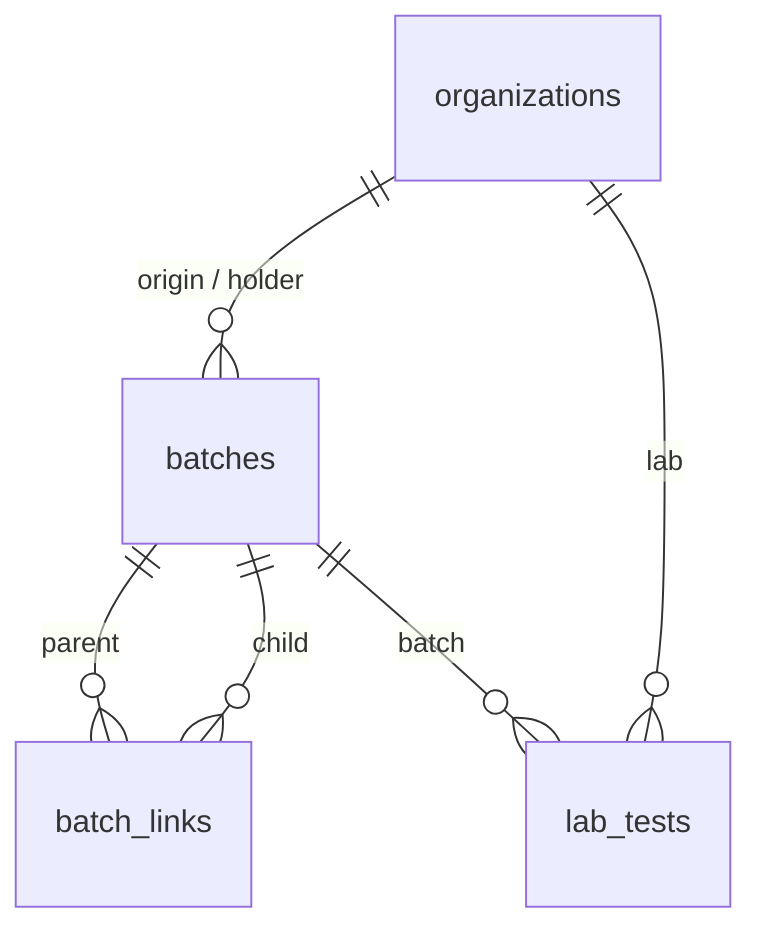
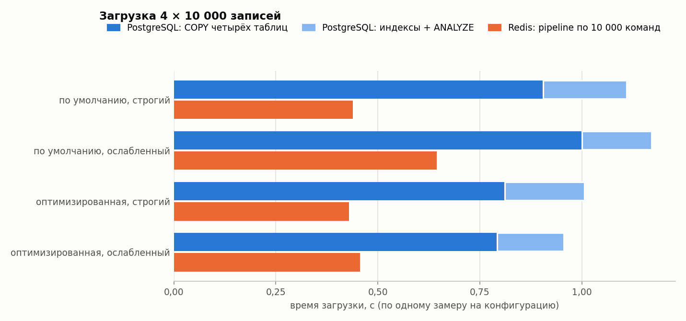
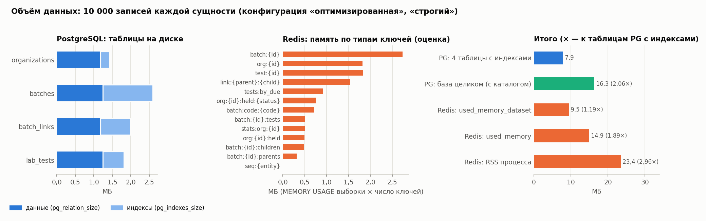
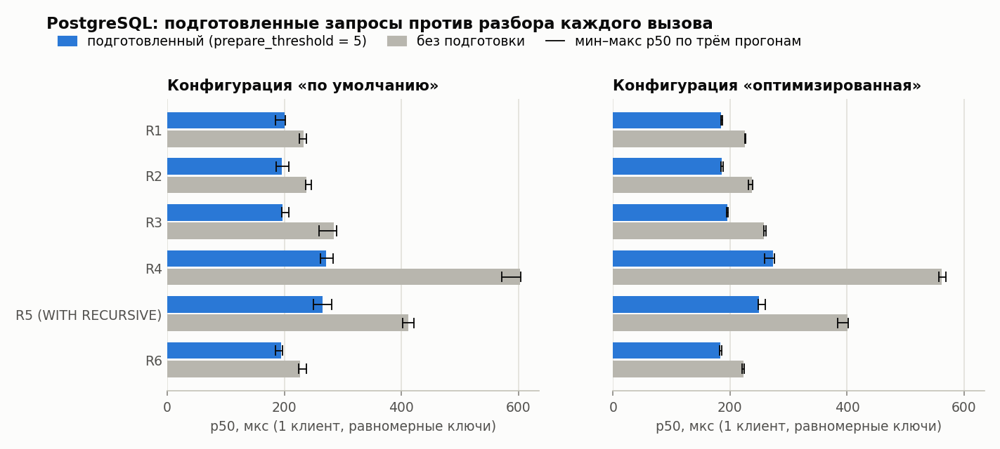
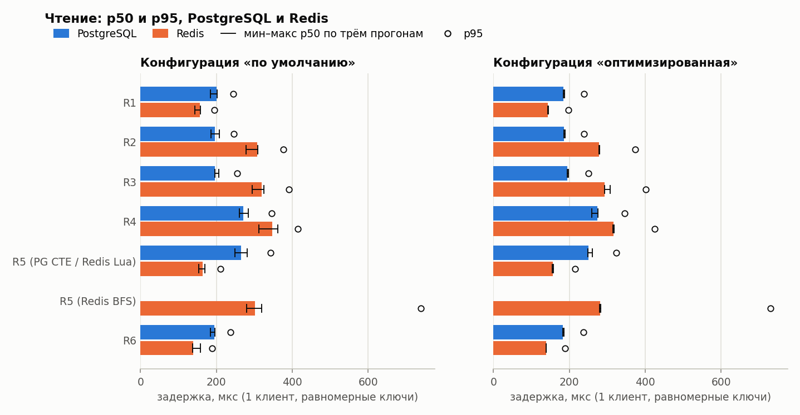
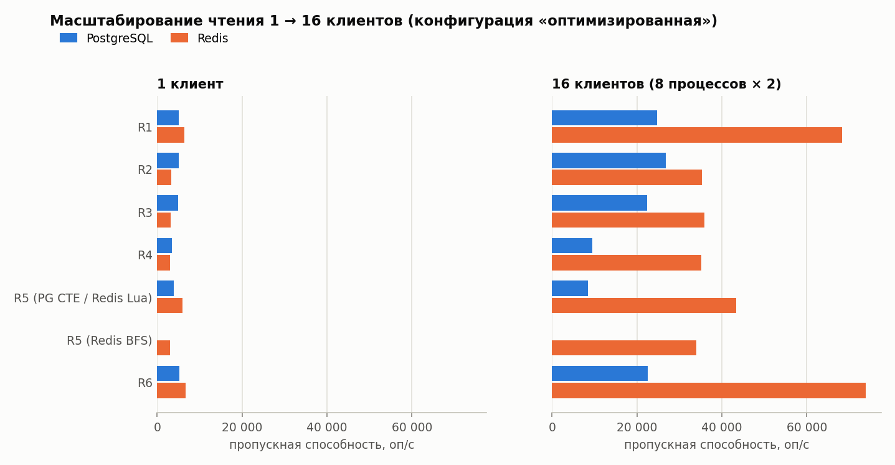
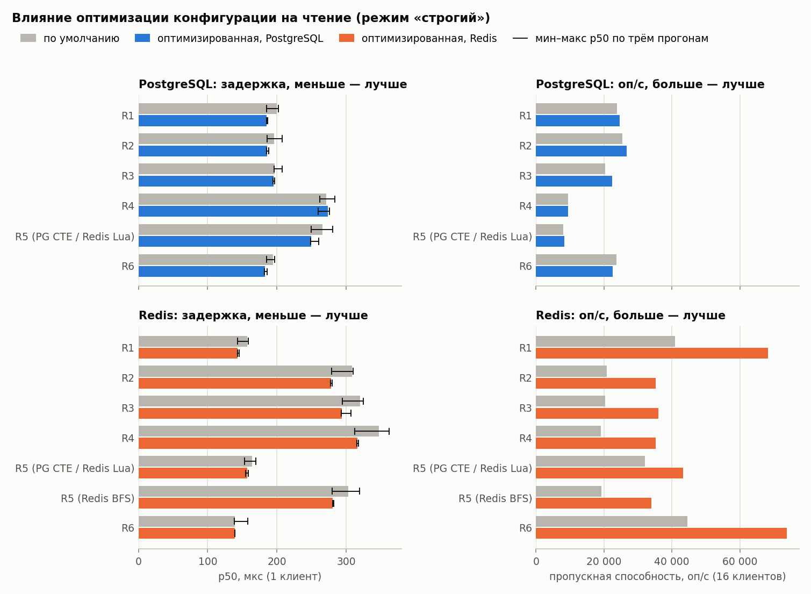
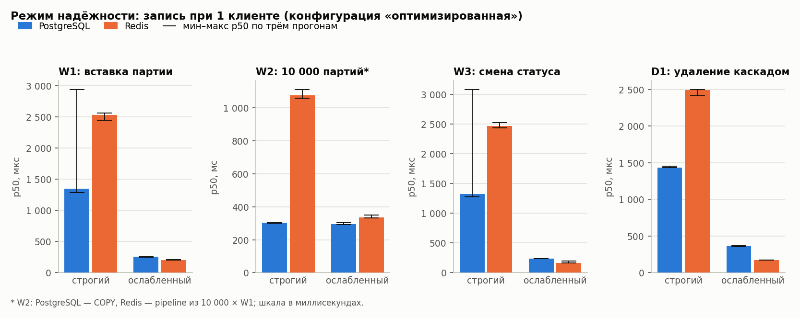
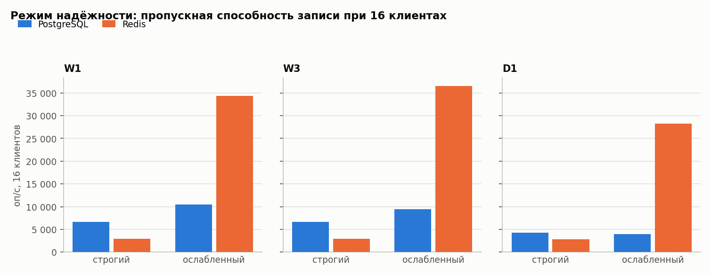
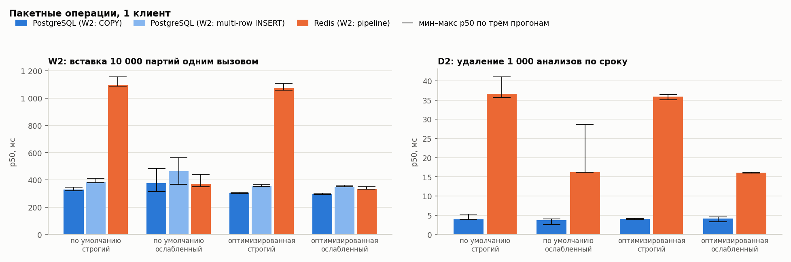

# Типы баз данных: PostgreSQL и Redis на данных AgroTrace

Отчёт по практической работе «Типы баз данных» (ТЗ, раздел 13).

Откуда берутся числа:

- **Данные.** Все исходные данные — CSV и JSON реального прогона в [`docs/reports/data/`](data/).
- **Таблицы.** Каждую таблицу пишет скрипт `benchmark/agrobench/report_tables.py` между маркерами `report_tables:begin/end`. Графики строит `benchmark/agrobench/plot.py`.
- **Проверка.** Тест `benchmark/tests/test_report_tables.py` проверяет четыре вещи:
  - каждый сгенерированный блок совпадает с тем, что скрипт строит из данных сейчас, поэтому правка вручную не пройдёт;
  - каждое число в таблицах есть в исходных файлах или вычислено из них скриптом (суммы, отношения, CPU на операцию), и при проверке эти числа пересчитываются заново;
  - таблиц с числами вне сгенерированных блоков нет;
  - каждое число в тексте, которое является результатом, встречается целым токеном в сгенерированных таблицах. Результатом считается число с дробной частью, с разделителем тысяч, с `%` или `×`, а также любое целое от `100`. Кроме того, в тексте запрещены десятичные точки (версии и константы пишутся как код), множитель «x» вместо «×» и непарные обратные кавычки в абзаце. Проверка не может заметить верное число, приписанное не тому запросу, конфигурации или метрике: она доказывает, что число — реальный результат, но не что фраза вокруг него его верно описывает.
- **Константы методики.** Размеры прогрева, пачек и серий, которых нет в данных, записаны как код (`1000`) и не сверяются.

## 1. Цель и задание

Цель: на сущностях AgroTrace сравнить реляционную СУБД (PostgreSQL 16) и хранилище «ключ — значение» (Redis `7.4`) и ответить, какие задачи системы выгоднее решать в каждой из них. Результат проверяет архитектурное решение раздела 8 ТЗ: PostgreSQL — основное хранилище, Redis — кэш и хранилище короткоживущих ключей.

Задание (ТЗ §13):

- четыре сущности по 10 000 записей, одинаковые данные в обеих СУБД;
- схема PostgreSQL с внешними ключами, CHECK и индексами, в том числе покрывающим;
- схема Redis на хешах, множествах, сортированных множествах и списках со вторичными индексами, которые поддерживает приложение;
- одиннадцать запросов: чтение R1–R6, запись W1–W3, удаление D1–D2;
- замеры p50, p95, p99, среднего и оп/с при 1 и 16 клиентах, на равномерных и «горячих» (Zipf `1.1`) ключах;
- две конфигурации каждой СУБД («по умолчанию» и «оптимизированная») и два режима надёжности («строгий» и «ослабленный»);
- 3 повтора каждого замера, в отчёт идёт медиана;
- графики, характеристики стенда, выводы.

## 2. Стенд

Стенд — отдельный compose-проект `agrotrace-bench` (`benchmark/docker-compose.yml`) из трёх контейнеров: `bench-postgres`, `bench-redis` и `bench-runner` (клиент на Python). Портов наружу он не публикует. Все команды запускаются через `./at.sh bench <команда>`. Характеристики стенд записывает сам в `env.json`: по одному файлу на конфигурацию в `data/env/`, сводный файл — последний из них.

<!-- report_tables:begin stand -->
| Характеристика | Значение |
|---|---|
| Процессор | AMD Ryzen 7 7700 8-Core Processor |
| Логических CPU, видимых контейнеру | 16 |
| ОЗУ, видимая контейнеру, МБ | 31 647,6 |
| ОС контейнеров (ядро WSL2) | Linux-6.18.33.2-microsoft-standard-WSL2-x86_64-with-glibc2.41 |
| Docker | Docker version 29.8.0, build 88096ef |
| Docker Compose | 5.5.1 |
| Лимиты bench-postgres и bench-redis | CPU 2,0, память 4 096 МБ (Redis: CPU 2,0, 4 096 МБ) |
| Диск с данными СУБД | /dev/sdd, ext4, 1 006,85 ГБ |
| PostgreSQL | 16.15 |
| Redis | 7.4.11 |
| Python | 3.12.14 |
| psycopg / psycopg-pool | 3.2.3 / 3.3.3 |
| redis-py / hiredis | 5.1.1 / 3.4.2 |
| numpy / matplotlib | 2.1.3 / 3.9.2 |
| Полный прогон `./at.sh bench all` | 2026-09-25T12:23:21Z … 2026-09-25T13:55:27Z, 5 526 с |
<!-- report_tables:end stand -->

Обе СУБД ограничены одинаково. Данные СУБД лежат на виртуальном диске WSL2 (ext4) внутри Docker Desktop, а не на файловой системе Windows. Поэтому fsync здесь — это сброс виртуального диска WSL2. Абсолютные времена записи в строгом режиме относятся к этому стенду и на серверное железо не переносятся.

## 3. Сущности и связи

<!-- report_tables:begin entities -->
| Сущность | Атрибуты | Записей |
|---|---|---:|
| organizations | id, type, name, inn, region_code, trust_rating, created_at | 10 000 |
| batches | id, public_code, product, origin_org_id, holder_org_id, kind, mass_kg, status, harvested_at, version | 10 000 |
| batch_links | parent_id, child_id, mass_used_kg, link_type, created_at | 10 069 |
| lab_tests | id, batch_id, lab_org_id, reason, conclusion, value, due_at | 10 000 |
<!-- report_tables:end entities -->

Связи:

- organizations 1:N batches — по происхождению (`origin_org_id`) и по держателю (`holder_org_id`);
- batches N:M batches через batch_links — ориентированный ациклический граф переработки;
- batches 1:N lab_tests;
- organizations 1:N lab_tests — через лабораторию (`lab_org_id`).

Число записей взято из количества ключей Redis после загрузки. В PostgreSQL загружены те же CSV, это проверяет тест эквивалентности данных (`tests/test_load_equivalence.py`).



## 4. Схемы

### 4.1. PostgreSQL

Файл схемы — `benchmark/agrobench/schema_pg.sql`. Все ключи имеют тип `bigint`, чтобы их можно было сравнивать с числовыми id в Redis. Есть внешние ключи и CHECK на перечисления и положительные массы. Поле `batches.version` нужно для оптимистичной блокировки в W3. У `batch_links` естественный первичный ключ `(parent_id, child_id)`.

| Индекс | Зачем |
|---|---|
| `batches(public_code)` UNIQUE | R2: поиск партии по коду с QR-этикетки, уникальность кода |
| `batches(holder_org_id, status, harvested_at DESC) INCLUDE (public_code, mass_kg)` | R3: фильтр и сортировка «держатель + статус, новые сначала» берутся из индекса; R6 использует его префикс |
| `batch_links(parent_id)`, `batch_links(child_id)` | R5: обход графа вниз; D1: удаление рёбер с обеих сторон |
| `lab_tests(batch_id)` | R4: анализы партии; D1 |
| `lab_tests(due_at)` | D2: удаление по сроку |

Почему так: реляционная модель хранит каждый факт один раз, а индексы, целостность связей и атомарность изменений поддерживает сама СУБД. Любой новый запрос по этим данным — фильтр, соединение или агрегат — пишется без изменения схемы хранения.

### 4.2. Redis

| Ключ | Тип | Содержимое и зачем |
|---|---|---|
| `org:{id}`, `batch:{id}`, `test:{id}` | Hash | атрибуты записи; R1 и R4 — один `HGETALL` |
| `batch:code:{public_code}` | String | id партии: уникальный вторичный индекс для R2 |
| `batch:{id}:children`, `batch:{id}:parents` | Set | рёбра графа в обе стороны: R5 вниз, D1 чистит соседей |
| `link:{parent}:{child}` | Hash | атрибуты ребра |
| `org:{id}:held` | Sorted Set | партии держателя, score — `harvested_at` |
| `org:{id}:held:{status}` | Sorted Set | то же с разбивкой по статусу: R3 одним `ZREVRANGE` |
| `batch:{id}:tests` | List | id анализов партии для R4 |
| `tests:by_due` | Sorted Set | анализы по `due_at` для D2 |
| `stats:org:{id}` | Hash | счётчики партий по статусам: R6 без вычислений |
| `seq:{entity}` | String | генерация id через `INCR` |

Почему так: в Redis нет запросов по значениям, есть только доступ по ключу. Поэтому под каждый запрос заранее строится своя структура:

- sorted set — для «последних N» и диапазонов по времени;
- set — для рёбер графа;
- hash — для счётчиков агрегата.

Цена такой схемы в том, что каждую вторичную структуру обновляет приложение, и обновлять её надо атомарно вместе с основной записью:

- W1 выполняет пять команд в `MULTI/EXEC`;
- W3 и D1 — Lua-скрипты;
- согласованность индексов проверяют тесты-инварианты (`tests/test_redis_invariants.py`).

Все осознанные различия реализаций описаны в `benchmark/ASYMMETRIES.md`.

## 5. Генерация и загрузка данных

Данные генерирует `benchmark/agrobench/generate.py` (seed фиксирован, `--scale` по умолчанию `10000`). Граф ацикличен по построению: у производной партии могут быть родителями только более ранние партии. `harvested_at` уникален во всём наборе, это нужно для одинакового порядка в R3.

Скрипт `agrobench/dataset_profile.py` сводит сгенерированные CSV, из которых загружены обе СУБД, в `data/dataset.csv`. Параметры генератора и фактические доли:

<!-- report_tables:begin dataset -->
| Показатель | по ТЗ / генератору | в данных | доля в данных |
|---|---:|---:|---:|
| сырьевые партии (RAW) | 60% | 6 000 | 60,0% |
| производные партии (DERIVED) | 40% | 4 000 | 40,0% |
| статус Approved | 45% | 4 431 | 44,3% |
| статус Accepted | 20% | 1 999 | 20,0% |
| статус OnSale | 15% | 1 520 | 15,2% |
| прочие статусы (8 шт., поровну) | 20% | 2 050 | 20,5% |
| анализы с итогом FAIL | 3% | 316 | 3,2% |
| производные с 1 родителем | 1–4, равновероятно | 997 | 24,9% |
| производные с 2 родителями | 1–4, равновероятно | 983 | 24,6% |
| производные с 3 родителями | 1–4, равновероятно | 974 | 24,3% |
| производные с 4 родителями | 1–4, равновероятно | 1 046 | 26,2% |
| рёбер графа (batch_links) | — | 10 069 | — |
| наибольшая глубина графа, рёбер | до 12 | 9 | — |
<!-- report_tables:end dataset -->

Доли совпадают с ТЗ с точностью до случайного разброса: например, Approved — 44,3% при заданных 45%, FAIL — 3,2% при 3%. Рёбер 10 069: у каждой из 4 000 производных партий от одного до четырёх родителей. Самый длинный путь в графе — 9 рёбер при допустимых 12.

Загрузка:

- **PostgreSQL** (`load_pg.py`): `COPY` в таблицы без вторичных индексов (первичные ключи объявлены в `CREATE TABLE`), затем создание шести вторичных индексов и `ANALYZE`.
- **Redis** (`load_redis.py`): pipeline по `10000` команд, на время загрузки выключены `save` и `appendonly`, после загрузки включается режим надёжности конфигурации.

Загрузка выполнялась по одному разу для каждой из четырёх конфигураций, поэтому ниже одиночные замеры, а не медианы.

<!-- report_tables:begin load -->
| Конфигурация | PG COPY organizations | COPY batches | COPY batch_links | COPY lab_tests | индексы + ANALYZE | PG всего | Redis всего |
|---|---:|---:|---:|---:|---:|---:|---:|
| по умолчанию, строгий | 0,023 | 0,297 | 0,294 | 0,292 | 0,204 | 1,110 | 0,439 |
| по умолчанию, ослабленный | 0,020 | 0,346 | 0,331 | 0,303 | 0,171 | 1,170 | 0,644 |
| оптимизированная, строгий | 0,023 | 0,251 | 0,257 | 0,280 | 0,195 | 1,006 | 0,429 |
| оптимизированная, ослабленный | 0,019 | 0,253 | 0,254 | 0,266 | 0,163 | 0,955 | 0,456 |
<!-- report_tables:end load -->



Redis загружается быстрее: pipeline только передаёт команды в память, а PostgreSQL пишет страницы таблиц вместе с индексами первичных ключей и затем строит вторичные индексы. Замеры неравноценны в одном: время Redis не включает чтение CSV в клиенте (файлы прочитаны до старта таймера), а время `COPY` включает разбор CSV на сервере. Разброс между конфигурациями (например, Redis 0,644 с в конфигурации «по умолчанию, ослабленный» против 0,429–0,456 с в остальных) — однократный замер на неизолированном хосте. Выводов о конфигурации из него делать нельзя.

Размер данных после загрузки:

<!-- report_tables:begin memory_pg -->
| Таблица | данные (pg_relation_size), МБ | индексы (pg_indexes_size), МБ | всего (pg_total_relation_size, с картами FSM/VM), МБ |
|---|---:|---:|---:|
| organizations | 1,18 | 0,25 | 1,45 |
| batches | 1,25 | 1,34 | 2,61 |
| batch_links | 1,18 | 0,81 | 2,02 |
| lab_tests | 1,25 | 0,57 | 1,84 |
| вся база (pg_database_size, вместе с системным каталогом) |  |  | 16,31 |
<!-- report_tables:end memory_pg -->

<!-- report_tables:begin memory_redis -->
| Ключ | ключей | MEMORY USAGE, байт на ключ (выборка) | оценка, МБ |
|---|---:|---:|---:|
| `batch:{id}` (Hash) | 10 000 | 273,6 | 2,74 |
| `org:{id}` (Hash) | 10 000 | 182,2 | 1,82 |
| `test:{id}` (Hash) | 10 000 | 184,0 | 1,84 |
| `link:{parent}:{child}` (Hash) | 10 069 | 152,0 | 1,53 |
| `tests:by_due` (Sorted Set) | 1 | 917 408,0 | 0,92 |
| `org:{id}:held:{status}` (Sorted Set) | 8 625 | 88,0 | 0,76 |
| `batch:code:{code}` (String) | 10 000 | 72,0 | 0,72 |
| `batch:{id}:tests` (List) | 6 340 | 81,1 | 0,51 |
| `stats:org:{id}` (Hash) | 5 935 | 84,5 | 0,50 |
| `org:{id}:held` (Sorted Set) | 5 935 | 83,0 | 0,49 |
| `batch:{id}:children` (Set) | 5 996 | 80,0 | 0,48 |
| `batch:{id}:parents` (Set) | 4 000 | 80,0 | 0,32 |
| `seq:{entity}` (String) | 3 | 58,7 | 0,00 |
<!-- report_tables:end memory_redis -->

<!-- report_tables:begin memory_totals -->
| Конфигурация | PG: база, МБ | Redis used_memory, МБ | dataset, МБ | overhead, МБ | RSS, МБ | фрагментация | ключей |
|---|---:|---:|---:|---:|---:|---:|---:|
| по умолчанию, строгий | 15,91 | 14,93 | 9,42 | 5,51 | 23,26 | 1,56 | 86 904 |
| по умолчанию, ослабленный | 16,30 | 14,93 | 9,42 | 5,51 | 23,09 | 1,55 | 86 904 |
| оптимизированная, строгий | 16,31 | 14,93 | 9,45 | 5,47 | 23,43 | 1,58 | 86 904 |
| оптимизированная, ослабленный | 16,41 | 14,93 | 9,45 | 5,47 | 23,29 | 1,57 | 86 904 |
<!-- report_tables:end memory_totals -->

Сравнение одного и того же:

<!-- report_tables:begin memory_compare -->
| Что (оптимизированная, строгий) | МБ | к таблицам PG с индексами |
|---|---:|---:|
| PostgreSQL: четыре таблицы с индексами (сумма pg_total_relation_size) | 7,91 | 1,00× |
| PostgreSQL: системный каталог и прочее (база минус таблицы) | 8,40 | — |
| PostgreSQL: база целиком (pg_database_size) | 16,31 | 2,06× |
| Redis: used_memory_dataset | 9,45 | 1,19× |
| Redis: used_memory | 14,93 | 1,89× |
| Redis: RSS процесса | 23,43 | 2,96× |
<!-- report_tables:end memory_compare -->



Как читать таблицы:

- «данные» — `pg_relation_size` (основной слой таблицы), «всего» — `pg_total_relation_size` (данные, индексы, карты видимости и свободного места).
- Оценки по ключам Redis — это средний `MEMORY USAGE` по выборке ключей, умноженный на их число. `MEMORY USAGE` учитывает и накладные расходы на сам ключ, поэтому сумма оценок не равна `used_memory_dataset`.

Выводы:

- **`pg_database_size` для сравнения не годится.** Размер базы (16,31 МБ) больше половины состоит из системного каталога (8,40 МБ).
- **Сравнение одного и того же.** Сами данные с индексами занимают в PostgreSQL 7,91 МБ на диске. Redis держит тот же набор в оперативной памяти:
  - 9,45 МБ полезных данных (`used_memory_dataset`, 1,19×);
  - 14,93 МБ всего по `used_memory` (1,89×);
  - 23,43 МБ RSS процесса (2,96×).
- **RSS выше `used_memory`.** В разницу входит фрагментация аллокатора и базовая память процесса Redis (код, буферы, резервы аллокатора). Опубликован только итоговый коэффициент `mem_fragmentation_ratio` (1,58), разложение разницы по причинам не измерялось.
- **Вторичные индексы Redis дорогие.** Структуры `held`, `held:{status}`, `stats`, `tests`, `children/parents` и `tests:by_due` — это копии связей, которые в PostgreSQL даёт один индекс или запрос.
- **Настройка listpack не повлияла на объём.** `hash-max-listpack-*` из оптимизированной конфигурации объём не изменила: хеши здесь маленькие и компактную кодировку получают уже при значениях по умолчанию.

## 6. Запросы

Реализации лежат в `benchmark/agrobench/queries/` (`pg.py`, `redis.py`, `lua/`). У функций обеих СУБД одинаковые сигнатуры. Тест `tests/test_query_equivalence.py` проверяет на малом наборе, что на одинаковых входах обе СУБД дают одинаковый логический результат для всех ключей, включая DAG с общими потомками. Каждый вызов в PostgreSQL — один SQL-оператор (один сетевой обмен). В Redis число обменов определяется моделью данных.

| # | Тип | PostgreSQL | Redis | Обменов с Redis |
|---|---|---|---|---|
| R1 | чтение | партия по id | `HGETALL batch:{id}` | один |
| R2 | чтение | партия по `public_code` | `GET batch:code:{c}`, затем `HGETALL` | два |
| R3 | чтение | партии держателя в статусе, новые сначала, `LIMIT 50` | `ZREVRANGE org:{id}:held:{s} 0 49`, затем pipeline `HGETALL` | два |
| R4 | связанные | партия + держатель + анализы: `JOIN` и `json_agg` | `HGETALL` партии и `LRANGE` анализов, затем pipeline `HGETALL` держателя и анализов | два |
| R5 | граф | потомки партии, `WITH RECURSIVE`, глубина до `20` | BFS в Python с pipeline `SMEMBERS` на уровень или Lua-скрипт | по уровням / один |
| R6 | агрегат | число партий держателя по статусам, `GROUP BY` | `HGETALL stats:org:{id}` | один |
| W1 | запись | `INSERT` партии | `MULTI`: hash, code, два zset, stats | один |
| W2 | запись | пакет партий: `COPY` и multi-row `INSERT` (`unnest`) | pipeline из W1 (без `MULTI` на весь пакет) | по `1000` партий |
| W3 | обновление | `UPDATE … WHERE version = $v` | Lua: проверка версии, `HSET`, перенос между zset, `HINCRBY` | один |
| D1 | удаление | партия с рёбрами и анализами: три `DELETE` в CTE одного оператора | Lua: hash, индексы, рёбра у соседей, анализы | один |
| D2 | удаление | `DELETE FROM lab_tests WHERE due_at < $t` | `ZRANGEBYSCORE tests:by_due`, затем pipeline удаления по `1000` | по два на пачку |

Ключевой код — обход графа (R5). PostgreSQL:

```sql
WITH RECURSIVE descendants(id, depth) AS (
    SELECT child_id, 1 FROM batch_links WHERE parent_id = %s
    UNION
    SELECT bl.child_id, d.depth + 1
    FROM batch_links bl
    JOIN descendants d ON bl.parent_id = d.id
    WHERE d.depth < %s
)
SELECT DISTINCT id FROM descendants
```

Redis, Lua-вариант (`lua/r5_descendants.lua`, вызывается через `EVALSHA`):

```lua
local visited, frontier, result, depth = { [ARGV[1]] = true }, { ARGV[1] }, {}, 0
while #frontier > 0 and depth < tonumber(ARGV[2]) do
  local next_frontier = {}
  for _, bid in ipairs(frontier) do
    for _, child in ipairs(redis.call('SMEMBERS', 'batch:' .. bid .. ':children')) do
      if not visited[child] then
        visited[child] = true
        table.insert(next_frontier, child); table.insert(result, child)
      end
    end
  end
  frontier, depth = next_frontier, depth + 1
end
return result
```

Смена статуса с проверкой версии (W3). В PostgreSQL это одна строка `UPDATE batches SET status = %s, version = version + 1 WHERE id = %s AND version = %s`. В Redis то же самое делает Lua-скрипт, который вручную переносит партию между индексами:

```lua
local current_version = redis.call('HGET', batch_key, 'version')
if not current_version or tonumber(current_version) ~= expected_version then return 0 end
local old_status = redis.call('HGET', batch_key, 'status')
local holder = redis.call('HGET', batch_key, 'holder_org_id')
redis.call('HSET', batch_key, 'status', new_status, 'version', tostring(expected_version + 1))
if old_status ~= new_status then
  redis.call('ZREM', 'org:' .. holder .. ':held:' .. old_status, id)
  local score = redis.call('ZSCORE', 'org:' .. holder .. ':held', id) or 0
  redis.call('ZADD', 'org:' .. holder .. ':held:' .. new_status, score, id)
  redis.call('HINCRBY', 'stats:org:' .. holder, old_status, -1)
  redis.call('HINCRBY', 'stats:org:' .. holder, new_status, 1)
end
return 1
```

Удаление с каскадом (D1) в PostgreSQL — один оператор. Проверки внешних ключей откладываются до конца оператора, поэтому `ON DELETE CASCADE` не нужен:

```sql
WITH deleted_tests AS (DELETE FROM lab_tests WHERE batch_id = %s),
     deleted_links AS (DELETE FROM batch_links WHERE parent_id = %s OR child_id = %s),
     deleted_batch AS (DELETE FROM batches WHERE id = %s RETURNING id)
SELECT count(*) FROM deleted_batch
```

## 7. Оптимизация

### 7.1. Что изменено и почему

<!-- report_tables:begin settings -->
| Параметр | по умолчанию | оптимизированная |
|---|---|---|
| PostgreSQL shared_buffers | 128MB | 1GB |
| PostgreSQL effective_cache_size | 4GB | 2867MB |
| PostgreSQL work_mem | 4MB | 32MB |
| PostgreSQL maintenance_work_mem | 64MB | 512MB |
| PostgreSQL random_page_cost | 4 | 1.1 |
| PostgreSQL effective_io_concurrency | 1 | 200 |
| PostgreSQL max_wal_size | 1GB | 4GB |
| Redis maxmemory | 0 | 3221225472 |
| Redis maxmemory-policy | noeviction | noeviction |
| Redis hash-max-listpack-entries | 128 | 512 |
| Redis hash-max-listpack-value | 64 | 128 |
| Redis lazyfree-lazy-user-del | no | yes |
| Redis lazyfree-lazy-server-del | no | yes |
| Redis io-threads | 1 | 2 |
| Redis save | 3600 1 300 100 60 10000 | "" (выключено) |
<!-- report_tables:end settings -->

**PostgreSQL.** Значения рассчитаны на лимит контейнера по правилу ТЗ §13.6:

- `shared_buffers` — `25%` памяти, `effective_cache_size` — `70%`;
- `work_mem` увеличен, чтобы сортировки и хеш-агрегаты не уходили на диск;
- `maintenance_work_mem` увеличен для построения индексов после `COPY`;
- `random_page_cost` снижен: данные в кэше и на SSD, случайное чтение почти не дороже последовательного;
- `effective_io_concurrency` — под SSD;
- `max_wal_size` увеличен, чтобы при записи реже срабатывали контрольные точки.

В обеих конфигурациях одинаковы покрывающий индекс для R3, `ANALYZE` после загрузки, пул соединений (`psycopg_pool`) и подготовленные запросы (psycopg готовит оператор на сервере с пятого выполнения на соединении). Конфигурация меняет только параметры сервера. Вклад подготовленных запросов измерен отдельно (п. 7.3).

**Redis:**

- `maxmemory` ниже лимита контейнера, политика `noeviction`: это хранилище данных, а не кэш, вытеснять ничего нельзя;
- крупнее пороги listpack для компактных хешей;
- `lazyfree-lazy-*`: освобождение памяти в фоновом потоке;
- `io-threads`: чтение и запись сокетов в дополнительном потоке;
- `save ""`: RDB-снимки отключены, надёжность обеспечивает только AOF.

В обеих конфигурациях одинаковы pipelining, Lua вместо цепочек запросов (Lua-вариант R5, W3, D1), отказ от `KEYS` и отключение персистентности на время загрузки. `SLOWLOG` и `LATENCY` включены для диагностики.

Режимы надёжности (ТЗ §13.6) заданы одинаково для обеих конфигураций. Значения в таблице прочитаны с работающих серверов (`SHOW` и `CONFIG GET`), расхождение с профилем прерывает прогон:

<!-- report_tables:begin durability -->
| Параметр (значение с работающего сервера) | строгий | ослабленный |
|---|---|---|
| PostgreSQL synchronous_commit | on | off |
| PostgreSQL fsync | on | on |
| PostgreSQL full_page_writes | on | on |
| PostgreSQL wal_sync_method | fdatasync | fdatasync |
| Redis appendonly | yes | yes |
| Redis appendfsync | always | everysec |
<!-- report_tables:end durability -->

### 7.2. Планы до и после

`EXPLAIN (ANALYZE, BUFFERS)` сохранён для R3, R4, R5 (медианный и самый большой набор потомков), R6, D1 и D2 во всех конфигурациях (`data/plans/`). Главное изменение плана даёт `random_page_cost`: при значении по умолчанию планировщик предпочитает Bitmap Heap Scan, после снижения — простой Index Scan.

**R3.** До оптимизации: Bitmap Index Scan, затем Bitmap Heap Scan и отдельная сортировка.

<!-- report_tables:begin plan_R3_default -->
```text
-- parameters: holder=7656 status=Approved (the pair with most batches: 6)
Limit  (cost=15.12..15.13 rows=3 width=83) (actual time=0.101..0.102 rows=6 loops=1)
  Buffers: shared hit=15 read=2
  ->  Sort  (cost=15.12..15.13 rows=3 width=83) (actual time=0.100..0.101 rows=6 loops=1)
        Sort Key: harvested_at DESC, id DESC
        Sort Method: quicksort  Memory: 25kB
        Buffers: shared hit=15 read=2
        ->  Bitmap Heap Scan on batches  (cost=4.32..15.10 rows=3 width=83) (actual time=0.041..0.064 rows=6 loops=1)
              Recheck Cond: ((holder_org_id = '7656'::smallint) AND ((status)::text = 'Approved'::text))
              Heap Blocks: exact=6
              Buffers: shared hit=9 read=2
              ->  Bitmap Index Scan on ix_batches_holder_status_harvested  (cost=0.00..4.32 rows=3 width=0) (actual time=0.033..0.033 rows=6 loops=1)
                    Index Cond: ((holder_org_id = '7656'::smallint) AND ((status)::text = 'Approved'::text))
                    Buffers: shared hit=3 read=2
Planning:
  Buffers: shared hit=161 read=2
Planning Time: 0.716 ms
Execution Time: 0.155 ms
```
<!-- report_tables:end plan_R3_default -->

После оптимизации: простой Index Scan по покрывающему индексу. Порядок `harvested_at DESC` берётся из индекса, поэтому остаётся только Incremental Sort для добивки по `id`.

<!-- report_tables:begin plan_R3_tuned -->
```text
-- parameters: holder=7656 status=Approved (the pair with most batches: 6)
Limit  (cost=1.78..4.88 rows=3 width=83) (actual time=0.177..0.179 rows=6 loops=1)
  Buffers: shared hit=18 read=2
  ->  Incremental Sort  (cost=1.78..4.88 rows=3 width=83) (actual time=0.177..0.177 rows=6 loops=1)
        Sort Key: harvested_at DESC, id DESC
        Presorted Key: harvested_at
        Full-sort Groups: 1  Sort Method: quicksort  Average Memory: 25kB  Peak Memory: 25kB
        Buffers: shared hit=18 read=2
        ->  Index Scan using ix_batches_holder_status_harvested on batches  (cost=0.29..4.74 rows=3 width=83) (actual time=0.065..0.121 rows=6 loops=1)
              Index Cond: ((holder_org_id = '7656'::smallint) AND ((status)::text = 'Approved'::text))
              Buffers: shared hit=9 read=2
Planning:
  Buffers: shared hit=160 read=2
Planning Time: 0.858 ms
Execution Time: 0.215 ms
```
<!-- report_tables:end plan_R3_tuned -->

Покрывающая часть индекса (`INCLUDE`) в этом запросе не даёт Index Only Scan: R3 возвращает все поля партии, и за ними всё равно нужно идти в таблицу.

**R4.** Анализы партии до оптимизации читаются через Bitmap Heap Scan, после — через Index Scan по `ix_lab_tests_batch`. Остальная часть плана одинакова: два Index Scan по первичным ключам и Nested Loop.

<!-- report_tables:begin plan_R4_default -->
```text
-- parameters: batch=6760 (most lab tests: 7)
Nested Loop  (cost=0.57..28.29 rows=1 width=166) (actual time=0.148..0.149 rows=1 loops=1)
  Buffers: shared hit=13 read=2
  ->  Index Scan using batches_pkey on batches b  (cost=0.29..8.30 rows=1 width=83) (actual time=0.026..0.026 rows=1 loops=1)
        Index Cond: (id = '6760'::smallint)
        Buffers: shared hit=3
  ->  Index Scan using organizations_pkey on organizations o  (cost=0.29..8.30 rows=1 width=51) (actual time=0.018..0.018 rows=1 loops=1)
        Index Cond: (id = b.holder_org_id)
        Buffers: shared hit=3
  SubPlan 1
    ->  Aggregate  (cost=11.67..11.68 rows=1 width=32) (actual time=0.098..0.099 rows=1 loops=1)
          Buffers: shared hit=7 read=2
          ->  Sort  (cost=11.65..11.65 rows=2 width=51) (actual time=0.072..0.073 rows=7 loops=1)
                Sort Key: t.id
                Sort Method: quicksort  Memory: 25kB
                Buffers: shared hit=7 read=2
                ->  Bitmap Heap Scan on lab_tests t  (cost=4.30..11.64 rows=2 width=51) (actual time=0.029..0.060 rows=7 loops=1)
                      Recheck Cond: (batch_id = b.id)
                      Heap Blocks: exact=7
                      Buffers: shared hit=7 read=2
                      ->  Bitmap Index Scan on ix_lab_tests_batch  (cost=0.00..4.30 rows=2 width=0) (actual time=0.022..0.022 rows=7 loops=1)
                            Index Cond: (batch_id = b.id)
                            Buffers: shared read=2
Planning:
  Buffers: shared hit=145 read=4
Planning Time: 0.811 ms
Execution Time: 0.214 ms
```
<!-- report_tables:end plan_R4_default -->

<!-- report_tables:begin plan_R4_tuned -->
```text
-- parameters: batch=6760 (most lab tests: 7)
Nested Loop  (cost=0.57..8.67 rows=1 width=166) (actual time=0.142..0.143 rows=1 loops=1)
  Buffers: shared hit=13 read=2
  ->  Index Scan using batches_pkey on batches b  (cost=0.29..2.50 rows=1 width=83) (actual time=0.023..0.024 rows=1 loops=1)
        Index Cond: (id = '6760'::smallint)
        Buffers: shared hit=3
  ->  Index Scan using organizations_pkey on organizations o  (cost=0.29..2.50 rows=1 width=51) (actual time=0.017..0.017 rows=1 loops=1)
        Index Cond: (id = b.holder_org_id)
        Buffers: shared hit=3
  SubPlan 1
    ->  Aggregate  (cost=3.66..3.67 rows=1 width=32) (actual time=0.097..0.098 rows=1 loops=1)
          Buffers: shared hit=7 read=2
          ->  Sort  (cost=3.63..3.63 rows=2 width=51) (actual time=0.071..0.071 rows=7 loops=1)
                Sort Key: t.id
                Sort Method: quicksort  Memory: 25kB
                Buffers: shared hit=7 read=2
                ->  Index Scan using ix_lab_tests_batch on lab_tests t  (cost=0.29..3.62 rows=2 width=51) (actual time=0.031..0.059 rows=7 loops=1)
                      Index Cond: (batch_id = b.id)
                      Buffers: shared hit=7 read=2
Planning:
  Buffers: shared hit=145 read=4
Planning Time: 0.884 ms
Execution Time: 0.204 ms
```
<!-- report_tables:end plan_R4_tuned -->

**R5** на самом большом наборе потомков. До оптимизации стартовый шаг рекурсии — Bitmap Heap Scan, после — Index Scan. Рекурсивный шаг в обоих случаях — Index Scan по `ix_batch_links_parent`, по одному на найденную вершину. Оценки стоимости упали примерно втрое, а фактическое время почти не изменилось.

<!-- report_tables:begin plan_R5_max_default -->
```text
-- parameters: batch=917 (largest descendant set: 22), max_depth=20
HashAggregate  (cost=1833.18..1835.18 rows=200 width=8) (actual time=0.162..0.164 rows=22 loops=1)
  Group Key: descendants.id
  Batches: 1  Memory Usage: 40kB
  Buffers: shared hit=60 read=8
  CTE descendants
    ->  Recursive Union  (cost=4.32..1826.54 rows=295 width=12) (actual time=0.027..0.155 rows=22 loops=1)
          Buffers: shared hit=60 read=8
          ->  Bitmap Heap Scan on batch_links  (cost=4.32..21.59 rows=5 width=12) (actual time=0.025..0.041 rows=5 loops=1)
                Recheck Cond: (parent_id = '917'::smallint)
                Heap Blocks: exact=5
                Buffers: shared hit=5 read=2
                ->  Bitmap Index Scan on ix_batch_links_parent  (cost=0.00..4.32 rows=5 width=0) (actual time=0.022..0.022 rows=5 loops=1)
                      Index Cond: (parent_id = '917'::smallint)
                      Buffers: shared read=2
          ->  Nested Loop  (cost=0.29..180.20 rows=29 width=12) (actual time=0.007..0.021 rows=3 loops=5)
                Buffers: shared hit=55 read=6
                ->  WorkTable Scan on descendants d  (cost=0.00..1.12 rows=17 width=12) (actual time=0.000..0.000 rows=4 loops=5)
                      Filter: (depth < '20'::smallint)
                ->  Index Scan using ix_batch_links_parent on batch_links bl  (cost=0.29..10.51 rows=2 width=16) (actual time=0.003..0.005 rows=1 loops=22)
                      Index Cond: (parent_id = d.id)
                      Buffers: shared hit=55 read=6
  ->  CTE Scan on descendants  (cost=0.00..5.90 rows=295 width=8) (actual time=0.028..0.157 rows=22 loops=1)
        Buffers: shared hit=60 read=8
Planning:
  Buffers: shared hit=50 read=2
Planning Time: 0.363 ms
Execution Time: 0.276 ms
```
<!-- report_tables:end plan_R5_max_default -->

<!-- report_tables:begin plan_R5_max_tuned -->
```text
-- parameters: batch=917 (largest descendant set: 22), max_depth=20
HashAggregate  (cost=562.48..564.48 rows=200 width=8) (actual time=0.169..0.171 rows=22 loops=1)
  Group Key: descendants.id
  Batches: 1  Memory Usage: 40kB
  Buffers: shared hit=60 read=8
  CTE descendants
    ->  Recursive Union  (cost=0.29..555.84 rows=295 width=12) (actual time=0.028..0.162 rows=22 loops=1)
          Buffers: shared hit=60 read=8
          ->  Index Scan using ix_batch_links_parent on batch_links  (cost=0.29..6.75 rows=5 width=12) (actual time=0.027..0.045 rows=5 loops=1)
                Index Cond: (parent_id = '917'::smallint)
                Buffers: shared hit=5 read=2
          ->  Nested Loop  (cost=0.29..54.61 rows=29 width=12) (actual time=0.008..0.022 rows=3 loops=5)
                Buffers: shared hit=55 read=6
                ->  WorkTable Scan on descendants d  (cost=0.00..1.12 rows=17 width=12) (actual time=0.000..0.000 rows=4 loops=5)
                      Filter: (depth < '20'::smallint)
                ->  Index Scan using ix_batch_links_parent on batch_links bl  (cost=0.29..3.12 rows=2 width=16) (actual time=0.003..0.005 rows=1 loops=22)
                      Index Cond: (parent_id = d.id)
                      Buffers: shared hit=55 read=6
  ->  CTE Scan on descendants  (cost=0.00..5.90 rows=295 width=8) (actual time=0.028..0.164 rows=22 loops=1)
        Buffers: shared hit=60 read=8
Planning:
  Buffers: shared hit=52 read=2
Planning Time: 0.356 ms
Execution Time: 0.265 ms
```
<!-- report_tables:end plan_R5_max_tuned -->

**D1.** Три удаления в одном операторе. План до и после одинаков по форме (Bitmap Heap Scan, BitmapOr по двум индексам рёбер), меняются только оценки стоимости. Заметная часть времени уходит на проверку внешних ключей (строки `Trigger for constraint`): это цена целостности, которой в Redis нет.

<!-- report_tables:begin plan_D1_default -->
```text
-- parameters: batch=6760 (rolled back)
Aggregate  (cost=58.91..58.92 rows=1 width=8) (actual time=0.107..0.108 rows=1 loops=1)
  Buffers: shared hit=13
  CTE deleted_tests
    ->  Delete on lab_tests  (cost=4.34..27.92 rows=0 width=0) (actual time=0.022..0.022 rows=0 loops=1)
          Buffers: shared hit=16
          ->  Bitmap Heap Scan on lab_tests  (cost=4.34..27.92 rows=7 width=6) (actual time=0.014..0.019 rows=7 loops=1)
                Recheck Cond: (batch_id = '6760'::smallint)
                Heap Blocks: exact=7
                Buffers: shared hit=9
                ->  Bitmap Index Scan on ix_lab_tests_batch  (cost=0.00..4.34 rows=7 width=0) (actual time=0.012..0.012 rows=7 loops=1)
                      Index Cond: (batch_id = '6760'::smallint)
                      Buffers: shared hit=2
  CTE deleted_links
    ->  Delete on batch_links  (cost=8.60..22.66 rows=0 width=0) (actual time=0.067..0.067 rows=0 loops=1)
          Buffers: shared hit=7 read=2
          ->  Bitmap Heap Scan on batch_links  (cost=8.60..22.66 rows=4 width=6) (actual time=0.062..0.064 rows=3 loops=1)
                Recheck Cond: ((parent_id = '6760'::smallint) OR (child_id = '6760'::smallint))
                Heap Blocks: exact=2
                Buffers: shared hit=4 read=2
                ->  BitmapOr  (cost=8.60..8.60 rows=4 width=0) (actual time=0.059..0.059 rows=0 loops=1)
                      Buffers: shared hit=2 read=2
                      ->  Bitmap Index Scan on ix_batch_links_parent  (cost=0.00..4.30 rows=2 width=0) (actual time=0.002..0.002 rows=1 loops=1)
                            Index Cond: (parent_id = '6760'::smallint)
                            Buffers: shared hit=2
                      ->  Bitmap Index Scan on ix_batch_links_child  (cost=0.00..4.30 rows=2 width=0) (actual time=0.056..0.056 rows=2 loops=1)
                            Index Cond: (child_id = '6760'::smallint)
                            Buffers: shared read=2
  CTE deleted_batch
    ->  Delete on batches  (cost=0.29..8.30 rows=1 width=6) (actual time=0.105..0.105 rows=1 loops=1)
          Buffers: shared hit=13
          ->  Index Scan using batches_pkey on batches  (cost=0.29..8.30 rows=1 width=6) (actual time=0.013..0.013 rows=1 loops=1)
                Index Cond: (id = '6760'::smallint)
                Buffers: shared hit=3
  ->  CTE Scan on deleted_batch  (cost=0.00..0.02 rows=1 width=0) (actual time=0.105..0.106 rows=1 loops=1)
        Buffers: shared hit=13
Planning Time: 0.060 ms
Trigger for constraint batch_links_parent_id_fkey on batches: time=0.185 calls=1
Trigger for constraint batch_links_child_id_fkey on batches: time=0.084 calls=1
Trigger for constraint lab_tests_batch_id_fkey on batches: time=0.087 calls=1
Execution Time: 0.773 ms
```
<!-- report_tables:end plan_D1_default -->

<!-- report_tables:begin plan_D1_tuned -->
```text
-- parameters: batch=6760 (rolled back)
Aggregate  (cost=18.80..18.81 rows=1 width=8) (actual time=0.089..0.089 rows=1 loops=1)
  Buffers: shared hit=13
  CTE deleted_tests
    ->  Delete on lab_tests  (cost=1.44..9.08 rows=0 width=0) (actual time=0.023..0.023 rows=0 loops=1)
          Buffers: shared hit=16
          ->  Bitmap Heap Scan on lab_tests  (cost=1.44..9.08 rows=7 width=6) (actual time=0.014..0.022 rows=7 loops=1)
                Recheck Cond: (batch_id = '6760'::smallint)
                Heap Blocks: exact=7
                Buffers: shared hit=9
                ->  Bitmap Index Scan on ix_lab_tests_batch  (cost=0.00..1.44 rows=7 width=0) (actual time=0.012..0.012 rows=7 loops=1)
                      Index Cond: (batch_id = '6760'::smallint)
                      Buffers: shared hit=2
  CTE deleted_links
    ->  Delete on batch_links  (cost=2.80..7.20 rows=0 width=0) (actual time=0.037..0.037 rows=0 loops=1)
          Buffers: shared hit=7 read=2
          ->  Bitmap Heap Scan on batch_links  (cost=2.80..7.20 rows=4 width=6) (actual time=0.034..0.036 rows=3 loops=1)
                Recheck Cond: ((parent_id = '6760'::smallint) OR (child_id = '6760'::smallint))
                Heap Blocks: exact=2
                Buffers: shared hit=4 read=2
                ->  BitmapOr  (cost=2.80..2.80 rows=4 width=0) (actual time=0.026..0.026 rows=0 loops=1)
                      Buffers: shared hit=2 read=2
                      ->  Bitmap Index Scan on ix_batch_links_parent  (cost=0.00..1.40 rows=2 width=0) (actual time=0.003..0.003 rows=1 loops=1)
                            Index Cond: (parent_id = '6760'::smallint)
                            Buffers: shared hit=2
                      ->  Bitmap Index Scan on ix_batch_links_child  (cost=0.00..1.40 rows=2 width=0) (actual time=0.022..0.022 rows=2 loops=1)
                            Index Cond: (child_id = '6760'::smallint)
                            Buffers: shared read=2
  CTE deleted_batch
    ->  Delete on batches  (cost=0.29..2.50 rows=1 width=6) (actual time=0.085..0.086 rows=1 loops=1)
          Buffers: shared hit=13
          ->  Index Scan using batches_pkey on batches  (cost=0.29..2.50 rows=1 width=6) (actual time=0.016..0.016 rows=1 loops=1)
                Index Cond: (id = '6760'::smallint)
                Buffers: shared hit=3
  ->  CTE Scan on deleted_batch  (cost=0.00..0.02 rows=1 width=0) (actual time=0.086..0.087 rows=1 loops=1)
        Buffers: shared hit=13
Planning Time: 0.070 ms
Trigger for constraint batch_links_parent_id_fkey on batches: time=0.184 calls=1
Trigger for constraint batch_links_child_id_fkey on batches: time=0.083 calls=1
Trigger for constraint lab_tests_batch_id_fkey on batches: time=0.086 calls=1
Execution Time: 0.703 ms
```
<!-- report_tables:end plan_D1_tuned -->

На этом наборе данных все планы выполняются за доли миллисекунды: весь набор помещается в `shared_buffers` даже в конфигурации по умолчанию. Смена плана видна в `EXPLAIN`, но почти не видна в задержке клиента (п. 9.3).

### 7.3. Подготовленные запросы PostgreSQL

Та же нагрузка (1 клиент, равномерные ключи, p50 в мкс) с отключённой подготовкой операторов. Последняя колонка каждой конфигурации — во сколько раз медленнее без подготовки:

<!-- report_tables:begin prepared -->
| Запрос | по умолчанию: подготовленный | без подготовки | без / с подготовкой | оптимизированная: подготовленный | без подготовки | без / с подготовкой |
|---|---:|---:|---:|---:|---:|---:|
| R1 | 199,9 | 233,2 | 1,17× | 184,9 | 226,0 | 1,22× |
| R2 | 196,1 | 237,0 | 1,21× | 185,4 | 237,2 | 1,28× |
| R3 | 196,3 | 284,4 | 1,45× | 195,0 | 258,3 | 1,32× |
| R4 | 271,0 | 603,0 | 2,23× | 273,3 | 561,2 | 2,05× |
| R5 (WITH RECURSIVE) | 265,6 | 411,9 | 1,55× | 249,6 | 400,4 | 1,60× |
| R6 | 194,2 | 226,9 | 1,17× | 182,8 | 222,5 | 1,22× |
<!-- report_tables:end prepared -->



Из всех оптимизаций PostgreSQL на этом наборе это самая заметная, и эффект зависит от сложности планирования (оптимизированная конфигурация):

- R4 (соединение с подзапросом): 273,3 против 561,2 мкс, в 2,05× медленнее без подготовки;
- R5 (рекурсия): 249,6 против 400,4 мкс, 1,60×;
- R3: 1,32×;
- R1 и R6: по 1,22×.

## 8. Методика

Как проводились замеры:

- **Клиент.** Python `3.12`, psycopg 3 (`AsyncConnectionPool`) и redis-py с hiredis (`redis.asyncio`). Время каждого вызова измеряется `time.perf_counter_ns` вокруг `await op(conn, *args)`. Сборщик мусора на время серии выключен.
- **Форма вызова.** Одинакова для обеих СУБД: один язык, одна форма вызова, одинаковые последовательности ключей и одинаковые подготовленные записи. Клиентские библиотеки при этом разные, и их расход CPU разный (п. 9.2). Код: `benchmark/agrobench/measure.py`, `workload.py`, `run.py`.
- **Чтение.** Прогрев — `1000` вызовов, затем `10000` измерений на случайных ключах. Ключи выбираются равномерно и по Zipf `1.1`: seed фиксирован, «горячее» множество одинаково для обеих СУБД.
- **Пачки для быстрых операций.** ТЗ предписывает замерять пачками по `1000` операции быстрее `50` мкс. Здесь таких не нашлось: самая быстрая медиана — 139,1 мкс (R6 у Redis), потому что сетевой переход Docker и клиент добавляются к каждому вызову. Все серии измерены поштучно, это записано в колонке `method` CSV.
- **Запись и удаление.** Операции идут на заранее подготовленных записях с id от 10⁹, так что основной набор не меняется. После каждой серии набор возвращается к исходному состоянию, и это проверяется отпечатком: для PostgreSQL — число строк и md5 всех строк, для Redis — `DBSIZE` и `DEBUG DIGEST`.
- **Объём серий записи.**
  - W1, W3, D1: `1000` измерений при 1 клиенте и `10000` при 16 клиентах.
  - W2 (пакет из `10000` партий): `20` измерений после `10` прогревочных. Поэтому для W2 приводятся только p50 и среднее, p95 и p99 на таком числе точек не показательны.
  - D2 (удаление `1000` анализов): `1000` измерений после `10` прогревочных.
  - W2 и D2 измерялись только при 1 клиенте.
- **16 клиентов.** Это 8 процессов по 2 asyncio-клиента, всего 16 соединений. Одного цикла событий Python не хватает, чтобы нагрузить СУБД. Каждый клиент прогревает своё соединение (не меньше 10 вызовов, то есть подготовленные операторы уже созданы), затем все берут вызовы из одной общей очереди.
  - «Эффективный параллелизм» (среднее × оп/с, закон Литтла) показывает, сколько вызовов в среднем реально выполнялось одновременно.
  - При 16 клиентах p50 всегда приводится вместе со средним, p99 и оп/с: хвост задержек здесь определяет пропускную способность.
- **Матрица.** Каждая СУБД измерялась отдельно во всех четырёх сочетаниях {по умолчанию, оптимизированная} × {строгий, ослабленный}; вторая СУБД в это время простаивала. Профиль простаивающей соседки на замер не влияет, поэтому полное произведение {PG} × {Redis} × {режим} свелось к этим четырём конфигурациям.
- **Повторы.** Каждая конфигурация прогнана 3 раза. В таблицах медиана трёх прогонов, в скобках — минимум и максимум по прогонам: для p50 из `measurements_median.csv`, для оп/с из `measurements.csv`.
- **Длительность.** Полный прогон `./at.sh bench all` с чистых томов — в таблице стенда (п. 2).

Ограничения, которые нужно учитывать при чтении чисел:

1. **Хост не был выделенным.** Параллельно работали другие compose-проекты (стек AgroTrace и т. п.), поэтому каждая конфигурация и прогнана трижды, а разброс показан. Примеры шума:
   - в конфигурации «оптимизированная, строгий» p50 W1 у PostgreSQL по прогонам — от 1 286,9 до 2 932,5 мкс (п. 9.4);
   - у PostgreSQL на чтении конфигурация «по умолчанию, ослабленный» медленнее остальных, с широким разбросом: например, R2 238,0 (185,7–266,7) мкс (п. 9.1).

   Такие расхождения конфигурации не приписываются.
2. **Задержки включают сетевой переход Docker и клиентское время Python/asyncio, и клиентская доля у двух СУБД разная.** По CPU клиентских процессов на одну операцию (п. 9.2) на R1 при 1 клиенте клиент PostgreSQL (psycopg) тратит 129,1 мкс CPU, клиент Redis (redis-py с hiredis) — 116,4. При 16 клиентах — 167,5 против 96,1. Часть разницы в задержке между СУБД создают клиентские библиотеки, а не серверы: на R1 при 1 клиенте разница CPU клиента покрывает от 31% разницы p50 в оптимизированной конфигурации (12,7 из 41,5 мкс) до 52% в конфигурации по умолчанию (22,4 из 42,8 мкс; таблица в п. 9.2). Оценка грубая: CPU клиента включает и цикл событий asyncio, стоимость которого зависит от числа ожиданий на вызов. Абсолютные значения — клиентские, а не серверные.
3. **Redis при 16 клиентах, вероятно, ограничен клиентом.** Клиентские процессы заняты на 6,57 ядра при 8 процессах на R1 и на 6,88 на R6. Эффективный параллелизм там 15,57 и 15,47, то есть клиенты не всё время держали запрос в работе. Реальный предел Redis, скорее всего, выше показанного. Отдельно, например с более мощным клиентом, это не проверялось.
4. **PostgreSQL при 16 клиентах, вероятно, упирается в лимит 2 CPU.** На это указывают три признака:
   - у тяжёлых запросов p99 измеряется десятками миллисекунд (R4 — 69 328,8 мкс);
   - клиенты при этом загружены слабо (2,07 ядра на R4);
   - среднее превышает p99 (у R1 639,6 при p99 616,3 мкс): несколько очень долгих вызовов из верхнего процента сдвигают среднее сильнее, чем меняют сам p99.

   Такие паузы характерны для CFS-квоты контейнера. Счётчики троттлинга (`cpu.stat`) в опубликованные данные не вошли, так что это объяснение, а не измерение.
5. **Данные маленькие** (единицы мегабайт) и целиком помещаются в память обеих СУБД. Замеры описывают работу с горячими данными, а не с диском.

## 9. Результаты

### 9.1. Чтение, 1 клиент

Равномерные ключи, режим «строгий» (на чтение режим надёжности не влияет). Задержки в микросекундах.

<!-- report_tables:begin reads_default -->
| Запрос | PG p50, мкс (мин–макс) | PG p95, мкс | PG p99, мкс | PG оп/с (мин–макс) | Redis p50, мкс (мин–макс) | Redis p95, мкс | Redis p99, мкс | Redis оп/с (мин–макс) |
|---|---:|---:|---:|---:|---:|---:|---:|---:|
| R1 | 199,9 (184,7–202,0) | 243,9 | 277,0 | 4 877 (4 830–5 162) | 157,1 (143,0–158,2) | 195,4 | 227,2 | 6 194 (6 167–6 457) |
| R2 | 196,1 (185,5–207,3) | 246,5 | 276,8 | 4 951 (4 709–5 097) | 308,1 (278,6–309,4) | 376,4 | 427,2 | 3 175 (3 155–3 340) |
| R3 | 196,3 (196,0–207,0) | 254,7 | 292,1 | 4 834 (4 651–4 838) | 319,8 (294,4–324,6) | 392,0 | 461,5 | 3 059 (3 008–3 199) |
| R4 | 271,0 (261,4–283,5) | 346,5 | 397,6 | 3 563 (3 412–3 713) | 346,9 (312,0–361,8) | 415,0 | 481,8 | 2 829 (2 692–3 060) |
| R5 (PG: WITH RECURSIVE, Redis: Lua) | 265,6 (249,4–280,6) | 343,3 | 401,2 | 3 645 (3 442–3 888) | 163,8 (153,1–169,8) | 210,6 | 249,4 | 5 839 (5 762–6 185) |
| R5 (Redis: BFS в Python) | — | — | — | — | 302,5 (279,2–318,9) | 738,4 | 1 001,8 | 2 933 (2 592–3 052) |
| R6 | 194,2 (184,5–196,5) | 237,4 | 270,0 | 5 025 (4 947–5 144) | 139,2 (138,2–157,9) | 188,4 | 223,6 | 6 594 (6 201–6 788) |
<!-- report_tables:end reads_default -->

<!-- report_tables:begin reads_tuned -->
| Запрос | PG p50, мкс (мин–макс) | PG p95, мкс | PG p99, мкс | PG оп/с (мин–макс) | Redis p50, мкс (мин–макс) | Redis p95, мкс | Redis p99, мкс | Redis оп/с (мин–макс) |
|---|---:|---:|---:|---:|---:|---:|---:|---:|
| R1 | 184,9 (184,7–186,6) | 239,0 | 281,5 | 5 150 (5 052–5 162) | 143,4 (143,2–145,4) | 197,7 | 236,7 | 6 468 (6 288–6 561) |
| R2 | 185,4 (185,2–188,4) | 238,1 | 281,2 | 5 144 (5 014–5 153) | 278,3 (277,6–279,8) | 373,1 | 434,8 | 3 360 (3 332–3 384) |
| R3 | 195,0 (194,1–196,9) | 250,2 | 290,2 | 4 896 (4 828–4 922) | 293,4 (293,0–307,0) | 401,1 | 470,3 | 3 179 (3 145–3 192) |
| R4 | 273,3 (259,3–275,3) | 345,4 | 393,5 | 3 551 (3 524–3 725) | 316,0 (315,4–317,9) | 424,5 | 497,4 | 3 006 (2 968–3 010) |
| R5 (PG: WITH RECURSIVE, Redis: Lua) | 249,6 (248,6–259,9) | 323,4 | 377,6 | 3 879 (3 741–3 909) | 156,7 (154,5–158,4) | 215,6 | 251,8 | 5 994 (5 928–6 130) |
| R5 (Redis: BFS в Python) | — | — | — | — | 280,7 (280,3–282,2) | 729,7 | 973,5 | 3 039 (3 015–3 088) |
| R6 | 182,8 (182,1–185,5) | 237,1 | 278,4 | 5 202 (5 129–5 215) | 139,1 (139,0–139,4) | 189,4 | 228,6 | 6 739 (6 707–6 741) |
<!-- report_tables:end reads_tuned -->



PostgreSQL во всех четырёх конфигурациях (p50, мин–макс по прогонам). Колонка «по умолчанию, ослабленный» отличается от остальных разбросом прогонов, а не параметрами: на чтение режим надёжности не влияет (см. ограничение 1).

<!-- report_tables:begin reads_pg_configs -->
| Запрос (PostgreSQL, 1 клиент) | по умолчанию, строгий | по умолчанию, ослабленный | оптимизированная, строгий | оптимизированная, ослабленный |
|---|---:|---:|---:|---:|
| R1 | 199,9 (184,7–202,0) | 214,4 (187,8–268,0) | 184,9 (184,7–186,6) | 185,0 (184,6–185,4) |
| R2 | 196,1 (185,5–207,3) | 238,0 (185,7–266,7) | 185,4 (185,2–188,4) | 185,3 (185,2–185,5) |
| R3 | 196,3 (196,0–207,0) | 234,1 (201,1–259,3) | 195,0 (194,1–196,9) | 196,8 (194,1–199,9) |
| R4 | 271,0 (261,4–283,5) | 288,1 (258,9–356,3) | 273,3 (259,3–275,3) | 277,6 (263,0–278,0) |
| R5 (PG: WITH RECURSIVE, Redis: Lua) | 265,6 (249,4–280,6) | 287,6 (248,0–325,8) | 249,6 (248,6–259,9) | 249,1 (246,0–251,6) |
| R6 | 194,2 (184,5–196,5) | 209,5 (183,8–247,5) | 182,8 (182,1–185,5) | 181,2 (181,0–186,6) |
<!-- report_tables:end reads_pg_configs -->

Равномерные ключи против Zipf `1.1` (конфигурация «оптимизированная», p50, мкс):

<!-- report_tables:begin reads_zipf -->
| Запрос | PG равномерно | PG Zipf 1.1 | Redis равномерно | Redis Zipf 1.1 |
|---|---:|---:|---:|---:|
| R1 | 184,9 | 188,0 | 143,4 | 143,6 |
| R2 | 185,4 | 185,7 | 278,3 | 277,5 |
| R3 | 195,0 | 194,8 | 293,4 | 287,9 |
| R4 | 273,3 | 267,2 | 316,0 | 311,5 |
| R5 (PG: WITH RECURSIVE, Redis: Lua) | 249,6 | 246,8 | 156,7 | 158,4 |
| R5 (Redis: BFS в Python) | — | — | 280,7 | 262,3 |
| R6 | 182,8 | 182,3 | 139,1 | 138,7 |
<!-- report_tables:end reads_zipf -->

«Горячие» ключи почти ничего не меняют: весь набор уже в памяти обеих СУБД, и кэшировать дополнительно нечего.

### 9.2. Чтение, 16 клиентов, и нагрузка клиента

Конфигурация «оптимизированная», равномерные ключи.

<!-- report_tables:begin reads_c16 -->
| Запрос · СУБД | p50, мкс | среднее, мкс | p99, мкс | оп/с (мин–макс) | эффективный параллелизм | CPU клиента, ядер |
|---|---:|---:|---:|---:|---:|---:|
| R1 · PostgreSQL | 329,5 | 639,6 | 616,3 | 24 672 (23 409–25 314) | 15,78 | 4,13 |
| R1 · Redis | 219,9 | 228,3 | 449,5 | 68 332 (66 564–77 641) | 15,57 | 6,57 |
| R2 · PostgreSQL | 327,9 | 589,1 | 557,4 | 26 747 (23 658–27 086) | 15,76 | 4,48 |
| R2 · Redis | 434,3 | 447,8 | 767,2 | 35 272 (34 512–36 187) | 15,81 | 6,48 |
| R3 · PostgreSQL | 349,1 | 674,9 | 853,2 | 22 338 (20 468–24 254) | 15,77 | 3,84 |
| R3 · Redis | 437,2 | 439,7 | 747,4 | 35 934 (35 558–39 587) | 15,80 | 6,78 |
| R4 · PostgreSQL | 445,5 | 1 675,4 | 69 328,8 | 9 498 (9 182–10 019) | 15,91 | 2,07 |
| R4 · Redis | 453,2 | 450,0 | 811,5 | 35 164 (30 820–38 001) | 15,81 | 7,04 |
| R5 (PG: WITH RECURSIVE, Redis: Lua) · PostgreSQL | 466,8 | 1 898,8 | 73 654,1 | 8 384 (7 897–8 404) | 15,91 | 1,67 |
| R5 (PG: WITH RECURSIVE, Redis: Lua) · Redis | 358,0 | 363,6 | 604,4 | 43 331 (38 442–44 641) | 15,77 | 4,46 |
| R5 (Redis: BFS в Python) · Redis | 382,9 | 465,9 | 1 495,9 | 33 948 (33 804–37 755) | 15,82 | 6,76 |
| R6 · PostgreSQL | 312,6 | 700,8 | 587,9 | 22 534 (21 825–23 596) | 15,79 | 3,54 |
| R6 · Redis | 196,2 | 210,9 | 399,2 | 73 817 (73 122–84 114) | 15,47 | 6,88 |
<!-- report_tables:end reads_c16 -->

CPU клиентских процессов: ядер и микросекунд CPU на одну операцию (`client_cpu_cores / ops_s`), конфигурация «оптимизированная».

<!-- report_tables:begin client_cpu -->
| Запрос | 1 клиент: PG, ядер | PG, мкс CPU/оп | Redis, ядер | Redis, мкс CPU/оп | 16 клиентов: PG, ядер | PG, мкс CPU/оп | Redis, ядер | Redis, мкс CPU/оп |
|---|---:|---:|---:|---:|---:|---:|---:|---:|
| R1 | 0,67 | 129,1 | 0,75 | 116,4 | 4,13 | 167,5 | 6,57 | 96,1 |
| R2 | 0,66 | 129,1 | 0,75 | 222,9 | 4,48 | 167,6 | 6,48 | 183,8 |
| R3 | 0,65 | 132,6 | 0,76 | 238,7 | 3,84 | 171,7 | 6,78 | 188,6 |
| R4 | 0,55 | 153,5 | 0,77 | 254,8 | 2,07 | 217,9 | 7,04 | 200,1 |
| R5 (PG: WITH RECURSIVE, Redis: Lua) | 0,49 | 126,8 | 0,70 | 116,6 | 1,67 | 199,3 | 4,46 | 102,9 |
| R5 (Redis: BFS в Python) | — | — | 0,76 | 250,4 | — | — | 6,76 | 199,3 |
| R6 | 0,65 | 124,0 | 0,75 | 111,3 | 3,54 | 157,3 | 6,88 | 93,1 |
<!-- report_tables:end client_cpu -->

Какую долю разницы p50 между PostgreSQL и Redis могла бы объяснить разница CPU клиента (1 клиент):

<!-- report_tables:begin client_gap -->
| Запрос · конфигурация (1 клиент) | PG p50, мкс | Redis p50, мкс | разница p50, мкс | PG, мкс CPU клиента/оп | Redis, мкс CPU клиента/оп | разница CPU, мкс | доля разницы p50 |
|---|---:|---:|---:|---:|---:|---:|---:|
| R1 · по умолчанию | 199,9 | 157,1 | 42,8 | 146,8 | 124,5 | 22,4 | 52% |
| R1 · оптимизированная | 184,9 | 143,4 | 41,5 | 129,1 | 116,4 | 12,7 | 31% |
| R6 · по умолчанию | 194,2 | 139,2 | 55,0 | 134,7 | 115,1 | 19,6 | 36% |
| R6 · оптимизированная | 182,8 | 139,1 | 43,7 | 124,0 | 111,3 | 12,7 | 29% |
<!-- report_tables:end client_gap -->



### 9.3. Оптимизация: до и после

Режим «строгий», равномерные ключи.

<!-- report_tables:begin optimization -->
| Запрос · СУБД | p50 при 1 клиенте, мкс: по умолчанию | оптимизированная | оп/с при 16 клиентах (мин–макс): по умолчанию | оптимизированная |
|---|---:|---:|---:|---:|
| R1 · PostgreSQL | 199,9 (184,7–202,0) | 184,9 (184,7–186,6) | 23 760 (22 311–23 829) | 24 672 (23 409–25 314) |
| R1 · Redis | 157,1 (143,0–158,2) | 143,4 (143,2–145,4) | 40 873 (38 830–41 724) | 68 332 (66 564–77 641) |
| R2 · PostgreSQL | 196,1 (185,5–207,3) | 185,4 (185,2–188,4) | 25 400 (23 297–25 904) | 26 747 (23 658–27 086) |
| R2 · Redis | 308,1 (278,6–309,4) | 278,3 (277,6–279,8) | 20 892 (20 523–21 865) | 35 272 (34 512–36 187) |
| R3 · PostgreSQL | 196,3 (196,0–207,0) | 195,0 (194,1–196,9) | 20 274 (19 468–22 814) | 22 338 (20 468–24 254) |
| R3 · Redis | 319,8 (294,4–324,6) | 293,4 (293,0–307,0) | 20 333 (20 197–22 158) | 35 934 (35 558–39 587) |
| R4 · PostgreSQL | 271,0 (261,4–283,5) | 273,3 (259,3–275,3) | 9 502 (9 168–9 937) | 9 498 (9 182–10 019) |
| R4 · Redis | 346,9 (312,0–361,8) | 316,0 (315,4–317,9) | 19 052 (16 427–21 290) | 35 164 (30 820–38 001) |
| R5 (PG: WITH RECURSIVE, Redis: Lua) · PostgreSQL | 265,6 (249,4–280,6) | 249,6 (248,6–259,9) | 8 053 (7 856–8 349) | 8 384 (7 897–8 404) |
| R5 (PG: WITH RECURSIVE, Redis: Lua) · Redis | 163,8 (153,1–169,8) | 156,7 (154,5–158,4) | 32 102 (28 625–33 315) | 43 331 (38 442–44 641) |
| R5 (Redis: BFS в Python) · Redis | 302,5 (279,2–318,9) | 280,7 (280,3–282,2) | 19 254 (18 878–20 806) | 33 948 (33 804–37 755) |
| R6 · PostgreSQL | 194,2 (184,5–196,5) | 182,8 (182,1–185,5) | 23 661 (22 810–24 706) | 22 534 (21 825–23 596) |
| R6 · Redis | 139,2 (138,2–157,9) | 139,1 (139,0–139,4) | 44 503 (42 755–45 782) | 73 817 (73 122–84 114) |
<!-- report_tables:end optimization -->



### 9.4. Запись и режимы надёжности

W1, W3, D1 в конфигурации «оптимизированная»: задержки в мкс, пропускная способность в оп/с, «клиентов» — 1 или 16.

<!-- report_tables:begin writes_tuned -->
| Запрос · клиентов · СУБД | строгий: p50, мкс (мин–макс) | среднее, мкс | p99, мкс | оп/с (мин–макс) | ослабленный: p50, мкс (мин–макс) | среднее, мкс | p99, мкс | оп/с (мин–макс) |
|---|---:|---:|---:|---:|---:|---:|---:|---:|
| W1 · 1 · PostgreSQL | 1 345,9 (1 286,9–2 932,5) | 1 361,5 | 1 728,6 | 734 (338–751) | 254,1 (248,4–257,1) | 261,1 | 372,7 | 3 809 (3 788–3 833) |
| W1 · 1 · Redis | 2 528,4 (2 445,1–2 556,3) | 2 636,2 | 5 749,4 | 379 (376–400) | 205,2 (204,9–207,6) | 213,6 | 307,0 | 4 655 (4 557–4 694) |
| W1 · 16 · PostgreSQL | 2 319,7 (2 309,6–2 324,9) | 2 393,8 | 5 417,3 | 6 658 (6 628–6 689) | 400,9 (395,5–434,2) | 1 514,4 | 72 019,4 | 10 499 (9 893–10 532) |
| W1 · 16 · Redis | 5 351,1 (5 273,1–5 364,9) | 5 423,6 | 11 305,0 | 2 944 (2 911–2 950) | 459,9 (435,3–495,7) | 460,1 | 730,2 | 34 305 (30 825–35 813) |
| W3 · 1 · PostgreSQL | 1 326,7 (1 275,2–3 079,4) | 1 366,7 | 2 175,2 | 731 (337–757) | 235,7 (234,0–238,3) | 246,4 | 349,5 | 4 025 (4 011–4 177) |
| W3 · 1 · Redis | 2 472,9 (2 439,9–2 524,4) | 2 534,7 | 5 605,1 | 394 (384–396) | 167,4 (165,8–197,0) | 178,6 | 261,4 | 5 556 (5 005–5 666) |
| W3 · 16 · PostgreSQL | 2 292,4 (2 289,5–2 293,2) | 2 397,1 | 5 728,3 | 6 651 (6 640–6 764) | 585,5 (563,4–590,0) | 1 686,5 | 65 565,3 | 9 444 (9 144–9 520) |
| W3 · 16 · Redis | 5 366,0 (5 312,6–5 806,8) | 5 446,1 | 11 347,8 | 2 932 (2 700–2 934) | 424,7 (417,9–426,1) | 432,6 | 692,4 | 36 546 (35 625–37 538) |
| D1 · 1 · PostgreSQL | 1 436,6 (1 436,4–1 452,2) | 1 519,4 | 4 574,4 | 657 (571–678) | 360,4 (357,2–368,2) | 376,2 | 526,9 | 2 648 (2 586–2 687) |
| D1 · 1 · Redis | 2 490,2 (2 416,4–2 495,3) | 2 548,4 | 5 641,7 | 392 (386–393) | 174,5 (172,5–175,1) | 182,3 | 278,5 | 5 447 (5 443–5 581) |
| D1 · 16 · PostgreSQL | 2 260,4 (2 257,4–2 274,5) | 3 713,4 | 42 842,9 | 4 282 (4 260–4 338) | 767,4 (762,6–784,1) | 4 002,3 | 81 287,9 | 3 987 (3 983–4 090) |
| D1 · 16 · Redis | 5 492,4 (5 468,7–5 540,1) | 5 612,7 | 11 568,0 | 2 846 (2 790–2 857) | 534,3 (525,5–537,5) | 561,0 | 897,9 | 28 270 (27 862–29 703) |
<!-- report_tables:end writes_tuned -->

То же в конфигурации «по умолчанию»:

<!-- report_tables:begin writes_default -->
| Запрос · клиентов · СУБД | строгий: p50, мкс (мин–макс) | среднее, мкс | p99, мкс | оп/с (мин–макс) | ослабленный: p50, мкс (мин–макс) | среднее, мкс | p99, мкс | оп/с (мин–макс) |
|---|---:|---:|---:|---:|---:|---:|---:|---:|
| W1 · 1 · PostgreSQL | 1 353,6 (1 291,8–1 389,0) | 1 399,9 | 4 433,7 | 713 (669–735) | 319,2 (281,8–410,5) | 329,7 | 490,7 | 3 016 (2 203–3 438) |
| W1 · 1 · Redis | 2 458,4 (2 436,9–2 671,4) | 2 564,7 | 5 558,4 | 390 (352–397) | 246,7 (240,6–257,1) | 250,9 | 339,6 | 3 962 (3 675–4 029) |
| W1 · 16 · PostgreSQL | 2 319,6 (2 313,3–2 326,2) | 2 444,4 | 5 652,9 | 6 520 (6 509–6 639) | 544,9 (402,5–810,5) | 1 818,6 | 66 513,6 | 8 741 (6 775–9 854) |
| W1 · 16 · Redis | 5 864,1 (5 790,5–6 113,8) | 5 898,2 | 11 573,2 | 2 707 (2 555–2 714) | 649,2 (640,3–795,3) | 658,6 | 1 162,9 | 24 093 (17 425–24 378) |
| W3 · 1 · PostgreSQL | 1 277,4 (1 230,6–1 311,7) | 1 327,0 | 1 842,0 | 752 (750–782) | 255,6 (211,8–365,6) | 269,0 | 415,8 | 3 694 (2 412–4 410) |
| W3 · 1 · Redis | 2 409,1 (2 387,4–2 534,2) | 2 503,2 | 5 456,0 | 399 (381–400) | 187,8 (169,4–237,3) | 190,4 | 265,9 | 5 209 (4 000–5 573) |
| W3 · 16 · PostgreSQL | 2 310,2 (2 295,4–2 332,9) | 2 392,1 | 5 651,6 | 6 665 (6 491–6 686) | 682,6 (551,2–872,3) | 1 870,8 | 60 466,1 | 8 493 (7 253–9 507) |
| W3 · 16 · Redis | 5 580,0 (5 577,0–5 945,1) | 5 169,8 | 9 254,0 | 3 089 (2 774–3 099) | 586,9 (566,4–778,1) | 610,3 | 993,1 | 26 009 (19 525–27 085) |
| D1 · 1 · PostgreSQL | 1 465,4 (1 448,9–1 475,6) | 1 542,1 | 3 040,9 | 648 (639–661) | 400,9 (375,4–644,7) | 427,2 | 718,8 | 2 332 (1 430–2 561) |
| D1 · 1 · Redis | 2 454,9 (2 397,5–2 529,0) | 2 570,9 | 5 607,9 | 389 (379–398) | 198,8 (175,1–214,5) | 202,9 | 281,8 | 4 893 (4 408–5 455) |
| D1 · 16 · PostgreSQL | 2 326,5 (2 269,7–2 339,1) | 3 951,4 | 43 495,2 | 4 037 (4 003–4 353) | 976,5 (798,1–1 110,6) | 4 385,6 | 78 052,2 | 3 636 (3 190–3 984) |
| D1 · 16 · Redis | 5 448,7 (5 416,1–6 119,8) | 5 119,7 | 11 857,8 | 3 120 (2 792–3 180) | 749,3 (681,6–1 038,3) | 808,6 | 1 538,0 | 19 666 (14 730–22 806) |
<!-- report_tables:end writes_default -->





Диагностика Redis (`data/redis/`). Первая таблица — события `aof-fsync-always` из `LATENCY` (порог 1 мс) в конфигурации «оптимизированная, строгий». Окно измерения — вся серия с прогревом для W1, W3 и D1 и один вызов (с прогревочными) для W2 и D2. Всего окон на серию: W2 — `30`, D2 — `1010`.

<!-- report_tables:begin redis_fsync -->
| Серия (Redis, оптимизированная, строгий) | прогон 1: окон с событием | макс. мс | прогон 2: окон | макс. мс | прогон 3: окон | макс. мс |
|---|---:|---:|---:|---:|---:|---:|
| W1 · 1 клиент | 1 | 9 | 1 | 9 | 1 | 9 |
| W1 · 16 клиентов | 1 | 9 | 1 | 9 | 1 | 9 |
| W3 · 1 клиент | 1 | 12 | 1 | 9 | 1 | 9 |
| D1 · 1 клиент | 1 | 9 | 1 | 8 | 1 | 9 |
| W2 | 30 | 9 | 30 | 11 | 30 | 9 |
| D2 | 1010 | 15 | 1010 | 13 | 1010 | 20 |
<!-- report_tables:end redis_fsync -->

<!-- report_tables:begin redis_fsync_relaxed -->
| Диагностика Redis | прогон 1 | прогон 2 | прогон 3 |
|---|---:|---:|---:|
| событий aof-fsync-always в LATENCY, оптимизированная, ослабленный | 0 | 0 | 0 |
<!-- report_tables:end redis_fsync_relaxed -->

Серверное время команд по `INFO commandstats`, мкс на вызов (оптимизированная, строгий):

<!-- report_tables:begin redis_commands -->
| Команда | прогон 1, мкс/вызов | прогон 2, мкс/вызов | прогон 3, мкс/вызов |
|---|---:|---:|---:|
| HGETALL | 2,01 | 1,88 | 1,93 |
| GET | 1,10 | 1,00 | 1,01 |
| ZREVRANGE | 1,42 | 1,47 | 1,41 |
| SMEMBERS | 0,88 | 0,80 | 0,80 |
| EVALSHA | 13,56 | 13,31 | 13,16 |
| EXEC | 9,39 | 9,22 | 9,69 |
| HSET | 2,21 | 2,16 | 2,16 |
| ZADD | 1,18 | 1,13 | 1,12 |
<!-- report_tables:end redis_commands -->

### 9.5. Пакетные операции

W2 (пакет партий за вызов) и D2 (удаление анализов по сроку). В каждой ячейке: p50 в мс (мин–макс по прогонам); среднее в мс.

<!-- report_tables:begin bulk -->
| Операция (p50, мс (мин–макс); среднее, мс) | по умолчанию, строгий | по умолчанию, ослабленный | оптимизированная, строгий | оптимизированная, ослабленный |
|---|---:|---:|---:|---:|
| W2 · PostgreSQL COPY | 327,7 (320,5–345,8); 336,3 | 377,7 (313,8–481,8); 396,9 | 302,8 (299,3–304,1); 303,6 | 295,5 (292,6–303,7); 309,1 |
| W2 · PostgreSQL multi-row INSERT | 383,6 (380,8–413,1); 387,9 | 465,5 (366,4–562,8); 470,2 | 354,7 (352,5–363,1); 362,3 | 348,8 (348,4–361,3); 356,0 |
| W2 · Redis pipeline | 1 098,4 (1 087,9–1 156,8); 1 103,5 | 371,2 (350,5–437,8); 376,4 | 1 075,4 (1 058,4–1 109,7); 1 071,2 | 334,1 (333,1–349,5); 344,7 |
| D2 · PostgreSQL | 3,94 (3,93–5,27); 4,12 | 3,74 (2,57–4,06); 4,11 | 4,02 (3,91–4,17); 4,46 | 4,09 (3,32–4,56); 4,31 |
| D2 · Redis | 36,67 (35,63–41,05); 41,03 | 16,16 (16,14–28,70); 16,70 | 35,85 (35,04–36,39); 39,58 | 16,06 (15,98–16,10); 16,41 |
<!-- report_tables:end bulk -->



## 10. Анализ

**Чтение по одному ключу — преимущество Redis, но небольшое.**

- R1 (партия по id): 143,4 мкс у Redis против 184,9 у PostgreSQL.
- R6 (счётчики по статусам): 139,1 против 182,8.

Почти вся задержка — это сеть и клиент. Серверное время `HGETALL` — около 2,01 мкс. Разница в десятки микросекунд складывается из двух частей:

- **клиентская.** Клиенту psycopg на R1 нужно 129,1 мкс CPU на операцию, клиенту redis-py с hiredis — 116,4 (п. 9.2);
- **серверная.** Остальное, по-видимому, серверная работа PostgreSQL: разбор протокола, исполнение подготовленного оператора, формирование строки результата. Против прямого доступа к хешу в Redis.

Серверное время PostgreSQL отдельно не измерялось.

При 16 клиентах разрыв растёт: Redis выполняет 68 332 оп/с на R1, PostgreSQL — 24 672. Но клиент Redis на R1 при этом загружен на 6,57 ядра, и предел Redis, вероятно, выше (ограничение 3). Клиент PostgreSQL на операцию тратит больше: 167,5 против 96,1 мкс CPU.

**Каждый лишний сетевой обмен стоит Redis больше, чем PostgreSQL платит за SQL.** R2, R3 и R4 требуют в Redis два последовательных обмена, и Redis проигрывает:

- R2: 278,3 мкс против 185,4;
- R3: 293,4 против 195,0;
- R4: 316,0 против 273,3.

Клиент Redis на таких запросах тратит больше CPU, чем клиент PostgreSQL (п. 9.2): каждый обмен и каждый ответ pipeline нужно отправить и разобрать. Один `JOIN` с `json_agg` в PostgreSQL обходится дешевле ручной сборки результата. Для Redis это означает правило: данные для одного ответа надо хранить под одним ключом.

**Граф.** Lua-скрипт, который обходит граф на сервере за один вызов, быстрее рекурсивного CTE: 156,7 против 249,6 мкс. BFS из Python делает обмен на каждый уровень и медленнее обоих (280,7), с тяжёлым хвостом (p95 729,7).

В этом графе у партии не больше 22 потомков (самый большой набор, план R5 в п. 7.2), и Lua, по-видимому, выигрывает за счёт того, что обход идёт прямо по структурам в памяти, без исполнителя SQL с рабочей таблицей рекурсии и хеш-агрегатом `DISTINCT`.

Цена этого выигрыша:

- рёбра хранятся дважды (`children` и `parents`) и поддерживаются вручную;
- скрипт блокирует однопоточный Redis на всё время обхода;
- целостности связей в Redis нет.

**Нагрузка на CPU: у PostgreSQL тяжёлый хвост при 16 клиентах.** Тяжёлые запросы PostgreSQL (R4, R5) дают около 9 тысяч оп/с (R4 — 9 498) с p99 69 328,8 мкс. Вероятная причина — лимит 2 CPU (ограничение 4). Redis держит на R4 35 164 оп/с.

**Запись в строгом режиме: PostgreSQL быстрее Redis.** Это главный результат, противоречащий привычному представлению о Redis как о «быстром» хранилище.

- При 1 клиенте W1 стоит 1 345,9 мкс у PostgreSQL против 2 528,4 у Redis. W3 и D1 ведут себя так же.
- При 16 клиентах PostgreSQL выполняет 6 658 вставок в секунду, Redis — 2 944.
- Серверная работа Redis ничтожна: `EXEC` с пятью командами — 9,39 мкс, `EVALSHA` — 13,56 мкс.
- В каждой серии записи в `LATENCY` есть события `aof-fsync-always`: наибольшее за серию — от 8 до 20 мс в зависимости от серии и прогона, а в ослабленном режиме таких событий нет.

Значит, остальное время Redis ждёт синхронизации AOF с диском.

Почему fsync дороже у Redis, отдельно не проверялось (например, через `strace`). Правдоподобные объяснения разные для одного и шестнадцати клиентов:

1. **1 клиент.** PostgreSQL при `synchronous_commit = on` сбрасывает WAL вызовом `fdatasync` в заранее выделенный сегмент WAL. Redis при `appendfsync always` дописывает команду в конец растущего AOF, и ext4, вероятно, приходится фиксировать в журнале ещё и изменение размера файла, то есть делать дополнительный сброс. Это согласуется с тем, что p50 Redis почти вдвое выше.
2. **16 клиентов.** В Redis fsync выполняется в основном потоке и покрывает команды одной итерации цикла событий, а пока он идёт, сервер никого не обслуживает. В PostgreSQL процессы-обработчики ждут сброса WAL независимо, и один сброс может покрыть коммиты нескольких процессов (групповой коммит).

**Запись в ослабленном режиме: Redis быстрее.** Без синхронного fsync у Redis остаётся только собственная работа:

- при 1 клиенте W1 — 205,2 мкс против 254,1 у PostgreSQL, W3 — 167,4 против 235,7, D1 — 174,5 против 360,4;
- при 16 клиентах W1 — 34 305 оп/с против 10 499.

У PostgreSQL в ослабленном режиме при 16 клиентах снова тяжёлый хвост: у W1 среднее 1 514,4 мкс при p50 400,9 и p99 72 019,4. У D1 ослабление надёжности пропускную способность не подняло: 3 987 оп/с против 4 282 в строгом режиме, p99 81 287,9 против 42 842,9 мкс. Вероятно, удаление с проверкой трёх внешних ключей при 16 клиентах ограничено процессором, а не fsync. Загрузку CPU сервера мы не измеряли.

**Пакетная запись.**

- В строгом режиме COPY в PostgreSQL вставляет пакет за 302,8 мс, multi-row `INSERT` — за 354,7 мс, pipeline Redis — за 1 075,4 мс. В строгом режиме событие `aof-fsync-always` есть во всех 30 окнах W2. Вероятно, pipeline сервер читает за несколько итераций цикла событий, и на каждой выполняется свой fsync.
- В ослабленном режиме все три близки: 295,5, 348,8 и 334,1 мс.

**Удаление по диапазону (D2) — область PostgreSQL.** Один `DELETE … WHERE due_at < $t` по индексу выполняется за единицы миллисекунд во всех конфигурациях. Redis тратит 35,85 мс в строгом режиме и 16,06 в ослабленном:

- разница между режимами — синхронизация AOF: событие `aof-fsync-always` есть во всех 1010 окнах D2;
- 16,06 мс ослабленного режима, вероятно, складываются из выборки id, чтения `batch_id` каждого анализа и трёх команд удаления на анализ (hash, `tests:by_due`, `LREM` из списка партии). Всё это pipeline, который собирает и разбирает клиент. По отдельности эти части не измерялись.

**Оптимизация конфигурации.**

- **PostgreSQL.** На чтении при 1 клиенте конфигурации отличаются меньше, чем прогоны между собой. Например, R1: 199,9 (184,7–202,0) против 184,9 (184,7–186,6). Планы стали проще (п. 7.2), но на наборе, который помещается в `shared_buffers`, это почти не видно. Пропускная способность при 16 клиентах тоже почти не изменилась. Заметно на PostgreSQL сработали только подготовленные запросы (п. 7.3).
- **Redis.** Настройка дала большой эффект при 16 клиентах: R1 — с 40 873 до 68 332 оп/с, R4 — с 19 052 до 35 164, и диапазоны прогонов не пересекаются. По-видимому, это работа `io-threads`: чтение и запись сокетов выносятся из основного потока. Вклад остальных изменений (`lazyfree`, `save ""`) отдельно не измерялся.
- **Запись.** Ни одна настройка конфигурации не меняет запись в строгом режиме: её цена — fsync.

**Память.** Сравнивать размер базы PostgreSQL целиком (16,31 МБ) нельзя: больше половины в нём — системный каталог. Сопоставимые величины:

- данные с индексами в PostgreSQL — 7,91 МБ на диске;
- в Redis — 9,45 МБ полезных данных (1,19×), 14,93 МБ `used_memory` (1,89×) и 23,43 МБ RSS (2,96×), причём всё это в оперативной памяти.

Рост данных в Redis упирается в объём ОЗУ, в PostgreSQL — в объём диска.

## 11. Плюсы и минусы

**PostgreSQL.**

Плюсы:

- любой запрос по данным без изменения схемы: соединения, фильтры, агрегаты, рекурсивный обход графа;
- целостность и каскады проверяет сама СУБД (внешние ключи, CHECK, уникальность);
- транзакции над несколькими таблицами;
- в строгом режиме надёжности запись в этих замерах дешевле, чем у Redis (1 345,9 против 2 528,4 мкс на W1). Вероятные причины, отдельно не проверенные: сброс WAL в заранее выделенный сегмент и групповой коммит при многих клиентах;
- пакетная загрузка (`COPY`) и удаление по диапазону — самые быстрые в замерах;
- на диске данные с индексами занимают меньше, чем Redis в памяти (7,91 МБ против 9,45 МБ одних полезных данных).

Минусы:

- каждый запрос несёт работу сервера и клиентской библиотеки: на простых чтениях это десятки микросекунд;
- без подготовленных операторов запросы медленнее. В оптимизированной конфигурации: R4 в 2,05×, R5 в 1,60×, R3 в 1,32×, простые R1 и R6 в 1,22×. В конфигурации по умолчанию: R4 в 2,23×, R5 в 1,55×, R3 в 1,45×, R1 и R6 в 1,17×;
- при 16 клиентах на лимите 2 CPU пропускная способность тяжёлых запросов ниже, а хвост задержек огромный (p99 R4 — 69 328,8 мкс);
- нужна настройка под железо (`shared_buffers`, `random_page_cost` и т. д.).

**Redis.**

Плюсы:

- минимальная задержка и максимальная пропускная способность для доступа к данным по одному ключу: R6 — 139,1 мкс и 73 817 оп/с при 16 клиентах;
- серверное время команд — единицы микросекунд;
- атомарные операции над структурами (`INCR`, `SET NX`, `GETDEL`, `ZADD`) и Lua-скрипты за один обмен;
- TTL у ключей;
- в ослабленном режиме надёжности самая быстрая запись (W1 — 34 305 оп/с при 16 клиентах).

Минусы:

- нет запросов по значениям: каждый путь доступа нужно заранее построить как отдельную структуру и поддерживать её в приложении атомарно;
- нет внешних ключей и целостности связей;
- любой ответ, собранный из нескольких ключей, требует нескольких обменов и проигрывает одному SQL-запросу;
- в строгом режиме (`appendfsync always`) запись медленнее PostgreSQL, а fsync выполняется в основном потоке;
- все данные в оперативной памяти: `used_memory` в 1,89× и RSS в 2,96× больше, чем данные с индексами у PostgreSQL на диске;
- однопоточное исполнение команд: долгий Lua-скрипт или `LREM` на большом списке задерживает всех клиентов.

## 12. Вывод: какие задачи AgroTrace решать в какой СУБД

Замеры подтверждают распределение ролей из раздела 8 ТЗ.

**В PostgreSQL:**

- **Основное хранилище и транзакции** — партии, передачи, анализы, отзывы. Нужны внешние ключи, каскады и оптимистичная блокировка (W3 — один `UPDATE`). В строгом режиме надёжности, обязательном для учётных данных, PostgreSQL в этих замерах ещё и пишет быстрее Redis: 1 345,9 против 2 528,4 мкс на W1, 6 658 против 2 944 оп/с при 16 клиентах.
- **Граф происхождения и отзыв.** Обход вниз `WITH RECURSIVE` работает за сотни микросекунд. Отзыв по §8.2 создаётся в транзакции `REPEATABLE READ` вместе с изменением статусов, и обход графа должен видеть тот же согласованный снимок. Lua-обход в Redis быстрее на маленьком графе, но потребовал бы держать рёбра в двух местах без целостности и синхронизировать их с PostgreSQL.
- **Аналитика и отчёты.** Произвольные `GROUP BY`, фильтры и соединения. Счётчик в Redis (R6) быстрее только потому, что заранее посчитан под один конкретный вопрос.
- **Массовые операции** — импорт (`COPY`), удаление и выборка по диапазонам (D2).

**В Redis** — там, где нужен один ключ, атомарная операция и TTL, а потеря последней секунды изменений допустима:

- **Кэш публичных QR-страниц** (`pub:batch:{publicCode}`). Кэш на стенде не моделировался: `GET` готового JSON-ответа не измерялся. Ближайшие измеренные операции — одно чтение небольшого хеша по ключу:
  - R6 — 139,1 мкс при 1 клиенте и 73 817 оп/с при 16;
  - R1 — 143,4 мкс и 68 332 оп/с.

  Это самые дешёвые и лучше всего масштабирующиеся операции стенда; PostgreSQL на R1 даёт 184,9 мкс и 24 672 оп/с. Следовательно, кэшировать нужно готовую страницу одним ключом: R2–R4 показывают, что сборка ответа из нескольких ключей Redis медленнее одного SQL-запроса.
- **Rate limiting** (`rl:{scope}:{id}`) и **ключи идемпотентности** (`idem:{userId}:{key}`): `INCR`/`SET NX` с TTL, одна команда, ключи общие для всех трёх backend-реализаций. Для них оправдан `appendfsync everysec`:
  - запись Redis в ослабленном режиме — 205,2 мкс на W1 против 2 528,4 в строгом;
  - потеря последней секунды счётчиков для этих задач безопасна.
- **Одноразовые коды** (`pwreset:`, `invite:`, `tgcode:`, `totp-used:`, `2fa:`) — `SET` с TTL и `GETDEL`, чтение и удаление атомарны.

Redis не должен быть системой учёта. Строгая надёжность в нём дороже, чем в PostgreSQL. Вторичные индексы и целостность связей пришлось бы переписывать в приложении, а объём ограничен оперативной памятью.

## 13. Воспроизведение

```bash
./at.sh bench all      # чистые тома → генерация и профиль данных → 4 конфигурации × (загрузка + 3 прогона)
                       # → публикация CSV в docs/reports/data → графики → таблицы отчёта
./at.sh bench plot     # только графики из docs/reports/data
./at.sh bench report   # только таблицы отчёта; report_tables --check — только проверка
./at.sh bench test     # тесты бенчмарка, включая сверку отчёта с CSV
```

После нового прогона таблицы и графики обновятся автоматически. Если числа изменятся, проверка укажет на числа в тексте анализа, которых больше нет в таблицах, и этот текст нужно будет переписать вручную.
