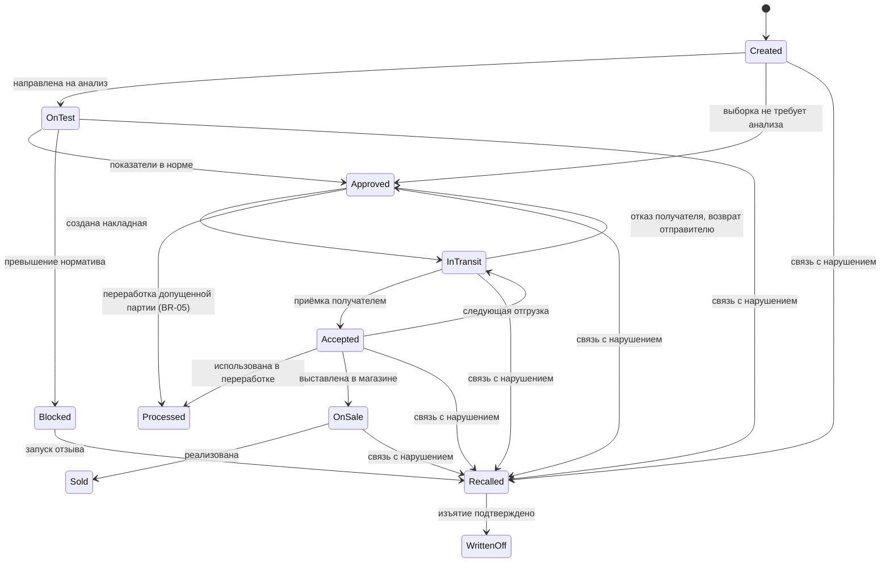
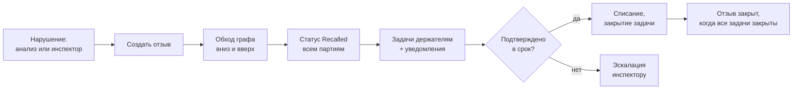
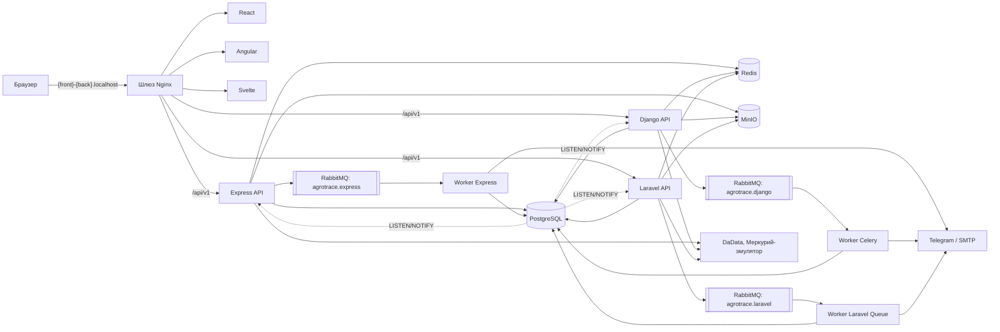
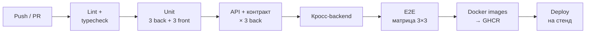

# ТЗ AgroTrace — система прослеживаемости продукции «от поля до прилавка»

Версия 2.0 · 23.09.2026

---

## 1. Общие сведения

AgroTrace — веб-система, которая связывает всех участников пищевой цепочки в единый граф партий и автоматически отзывает опасную продукцию по всей цепочке.

| Параметр | Значение |
|---|---|
| Полное наименование | Информационная система прослеживаемости сельскохозяйственной продукции «от поля до прилавка» |
| Краткое наименование | AgroTrace |
| Английское наименование | AgroTrace — Farm-to-Shelf Product Traceability System |
| Основание | ИТ-проект магистратуры ВлГУ, направление 09.04.04 «Программная инженерия»; практические работы «Клиентская часть», «Серверная часть», «Типы баз данных» |
| Исполнитель | 1 студент |
| Тип системы | Клиент-серверное веб-приложение: 3 реализации SPA × 3 реализации REST API на общей PostgreSQL, любые комбинации |
| Версия документа | 2.0 |

### 1.1. Термины и определения

| Термин | Определение |
|---|---|
| Партия | Учётная единица продукции с уникальным кодом, массой, происхождением и статусом |
| Сырьевая партия | Партия урожая, созданная фермером и привязанная к полю |
| Производная партия | Партия, созданная переработчиком из одной или нескольких входных партий |
| Граф партий | Ориентированный ациклический граф связей «входная партия → выходная партия» |
| Обработка | Внесение препарата (пестицид, удобрение) на поле с датой, дозой и препаратом |
| Срок ожидания | Минимальное число дней от последней обработки препаратом до уборки или отгрузки |
| Норматив | Предельно допустимое значение показателя (например, остаток пестицида, мг/кг) для продукта |
| Отзыв | Процесс блокировки и изъятия из оборота всех партий, связанных с нарушением |
| Держатель | Организация, у которой партия находится в данный момент |
| RBAC | Role-Based Access Control — управление доступом на основе ролей |
| Реализация | Одна из трёх версий frontend (React, Angular, Svelte) или backend (Express, Django, Laravel) |
| Комбинация | Пара «frontend + backend», доступная по отдельному адресу; всего 9 |
| Шлюз | Nginx, который по имени хоста отдаёт нужный frontend и проксирует `/api` на нужный backend |
| Контракт | Файл `contracts/openapi.yaml` — единственный источник истины об API для всех реализаций |
| Тест-вектор | JSON-файл «вход → ожидаемый результат» для бизнес-правила; общий для unit-тестов всех backend |
| Дизайн-система «Поле» | Собственная система токенов, компонентов и правил подачи интерфейса (раздел 10) |

### 1.2. Соответствие требованиям практических работ

| Требование практической работы | Где выполняется |
|---|---|
| **ПР «Клиентская часть»** | |
| Целостность (одна функция) | Прослеживаемость и отзыв партий (разделы 2–5) |
| ≥ 2 страниц с различными URL | Карта маршрутов, п. 9.4 (≈ 35 маршрутов) |
| Дизайн-концепция, не стоковые компоненты | Дизайн-система «Поле», раздел 10; UI-библиотеки запрещены |
| Адаптивный дизайн | Все экраны от 360 px, п. 9.3 |
| Формы ввода и их обработка | Все формы валидируются общими Zod-схемами, п. 9.1 |
| Изображения | Фото продуктов, аватарки, логотипы, контуры полей, QR, иллюстрации, п. 9.6 |
| 3 технологии, одинаковое поведение | React, Angular, Svelte; общие e2e-тесты на 9 комбинациях, п. 14.1 |
| **ПР «Серверная часть»** | |
| Целостность | То же |
| Доступ ко всем функциям через HTTP API | REST `/api/v1`, раздел 8; frontend не имеет других каналов к данным |
| Подключение к БД | PostgreSQL 16, раздел 7 |
| Вход в систему и разграничение ролей | JWT + RBAC, раздел 4, п. 8.3 |
| Загрузка и скачивание файлов | Аватарки, логотипы, фото продуктов, PDF-протоколы, QR, экспорт/импорт, п. 8.6 |
| 3 технологии, одинаковое поведение | Express, Django, Laravel; общие API-тесты, контрактные тесты и тест-векторы, п. 14.1 |
| **ПР «Типы баз данных»** | |
| ≥ 3 связанных сущности × ≥ 5 атрибутов | 4 сущности, п. 13.1 |
| Схема для каждой СУБД | PostgreSQL п. 13.2, Redis п. 13.3 |
| Объём тестовых данных | 10 000 записей на сущность (параметр масштаба), п. 13.4 |
| Чтение, запись, удаление, связанные сущности | 11 запросов, п. 13.5 |
| Оптимизация СУБД | Замеры «по умолчанию» и «после оптимизации», п. 13.6 |
| **Все ПР** | |
| Отчёт: работа, сравнение, плюсы/минусы, вывод | Три отчёта, п. 15.4 |

---

## 2. Назначение и цели создания системы

Система нужна, чтобы любую партию продукции можно было проследить от поля до магазина, а опасную продукцию — отозвать по всей цепочке за минуты, а не дни.

Цели:

- Создать цифровой паспорт для каждой партии: поле, обработки, анализы, все держатели.
- Автоматизировать контроль качества: результаты анализов сравниваются с нормативами, статус партии меняется без участия человека.
- Автоматизировать отзыв: одно нарушение блокирует все связанные партии и уведомляет всех держателей.
- Дать покупателю прозрачность: по QR-коду видно происхождение и статус безопасности продукта.
- Дать инспектору аналитику по производителям, нарушениям и скорости отзывов.
- Сравнить на одной предметной области три frontend-технологии, три backend-технологии и две СУБД.

Критерии успеха (целевые показатели):

| Показатель | Целевое значение |
|---|---|
| Время от внесения результата анализа с нарушением до уведомления всех держателей | не более 1 минуты |
| Доля партий в продаже, прослеживаемых до поля и анализа | 100% |
| Время загрузки публичной QR-страницы | не более 1 секунды (p95) |
| Покрытие unit-тестами модулей бизнес-логики | не менее 70% в каждой backend-реализации |
| Число бизнес-процессов, автоматизированных сквозным workflow | не менее 5 |
| Комбинаций frontend × backend, проходящих общий e2e-набор | 9 из 9 |
| Backend-реализаций, проходящих общий API-набор и контрактные тесты | 3 из 3 |

---

## 3. Предметная область

### 3.1. Описание и проблема

Сельхозпродукция проходит цепочку: фермер → лаборатория → переработчик → торговая сеть → покупатель. Каждый участник ведёт свой учёт, часто на бумаге, и данные между участниками не связаны.

Из-за этого возникают три проблемы:

1. **Медленный отзыв.** При обнаружении опасной партии держателей ищут вручную по накладным, а продукция тем временем продаётся.
2. **Отсутствие доверия.** Добросовестный фермер не может доказать качество продукции, покупатель не может её проверить.
3. **Смешение партий.** При переработке сырьё разных хозяйств объединяется, и после этого установить источник нарушения почти невозможно.

Существующие государственные системы покрывают отдельные этапы цепочки и не показывают покупателю полную историю продукта.

### 3.2. Целевая аудитория

Малые и средние фермерские хозяйства, перерабатывающие предприятия, аккредитованные лаборатории, региональные торговые сети, органы контроля качества, конечные покупатели.

### 3.3. Обоснование необходимости разработки

Система сокращает время отзыва, снижает риск отравлений и даёт производителям конкурентное преимущество — подтверждённое качество. Для торговых сетей это снижение репутационных и юридических рисков.

### 3.4. Основные сценарии использования

| № | Актор | Сценарий |
|---|---|---|
| UC-01 | Фермер | Регистрирует поле и обработку препаратом |
| UC-02 | Фермер | Создаёт партию урожая и отгружает её переработчику |
| UC-03 | Лаборант | Принимает партию на анализ и вносит результаты |
| UC-04 | Переработчик | Принимает партию и выпускает из неё продукцию |
| UC-05 | Магазин | Принимает партию и печатает QR-коды |
| UC-06 | Покупатель | Сканирует QR и видит историю продукта |
| UC-07 | Покупатель | Оставляет жалобу на продукт |
| UC-08 | Система | Автоматически запускает отзыв при нарушении |
| UC-09 | Держатель | Подтверждает изъятие отозванной партии |
| UC-10 | Инспектор | Разбирает жалобу, назначает внеплановый анализ |
| UC-11 | Инспектор | Просматривает аналитику и формирует отчёт |
| UC-12 | Администратор | Управляет пользователями, организациями и справочниками |
| UC-13 | Любой авторизованный | Загружает аватарку, скачивает документы партии |

---

## 4. Пользователи и ролевая модель

В системе 7 ролей. Шесть работают через авторизацию в рамках своей организации, покупатель — без авторизации через публичную страницу.

### 4.1. Роли

| Код | Роль | Организация | Назначение |
|---|---|---|---|
| FARMER | Фермер | Фермерское хозяйство | Ведёт поля, обработки, сырьевые партии, отгрузки |
| PROCESSOR | Переработчик | Перерабатывающее предприятие | Принимает сырьё, выпускает производные партии |
| LAB | Лаборант | Лаборатория | Проводит анализы, вносит результаты |
| RETAILER | Сотрудник магазина | Торговая сеть | Принимает партии, печатает QR, изымает при отзыве |
| INSPECTOR | Инспектор | Орган контроля | Видит всю цепочку, аналитику, жалобы, может запустить отзыв |
| ADMIN | Администратор | Платформа | Пользователи, организации, справочники, аудит |
| PUBLIC | Покупатель | — | Просмотр QR-страницы и отправка жалобы |

Внутри организации поддерживаются два уровня: сотрудник (операции) и руководитель организации (сотрудник + управление сотрудниками своей организации + отчёты организации). Итоговая иерархия: Сотрудник → Руководитель организации → Инспектор → Администратор.

### 4.2. Разграничение данных

- Участник видит только партии, которые создал, держит сейчас или держал раньше, и их непосредственных поставщиков и получателей.
- Инспектор видит весь граф и все организации только на чтение, кроме операций отзыва, жалоб и внеплановых проверок.
- Лаборант видит только партии, направленные на анализ в его лабораторию.
- Покупатель видит публичное подмножество: продукт, происхождение (регион, хозяйство), даты, итог анализов, статус. Персональные данные сотрудников не показываются.
- Файлы наследуют права сущности, к которой привязаны: протокол анализа доступен тем, кто видит анализ; аватарка — любому авторизованному; фото продукта и логотип хозяйства — публично.

### 4.3. Матрица прав (основные операции)

| Операция | FARMER | PROCESSOR | LAB | RETAILER | INSPECTOR | ADMIN |
|---|---|---|---|---|---|---|
| Поля и обработки: создание/изменение | ✓ | — | — | — | чтение | чтение |
| Сырьевая партия: создание | ✓ | — | — | — | — | — |
| Производная партия: создание | — | ✓ | — | — | — | — |
| Накладная: создание / приёмка | ✓ / — | ✓ / ✓ | — | — / ✓ | чтение | чтение |
| Анализ: внесение результатов | — | — | ✓ | — | — | — |
| Анализ: загрузка PDF-протокола | — | — | ✓ | — | — | — |
| Внеплановый анализ: назначение | — | — | — | — | ✓ | — |
| Отзыв: ручной запуск | — | — | — | — | ✓ | — |
| Задача отзыва: подтверждение | ✓ | ✓ | — | ✓ | чтение | — |
| Генерация QR | — | ✓ | — | ✓ | — | — |
| Жалобы: рассмотрение | — | — | — | — | ✓ | — |
| Аналитика | своя орг. | своя орг. | своя лаб. | своя орг. | вся система | вся система |
| Справочники (продукты, препараты, нормативы) | чтение | чтение | чтение | чтение | чтение | ✓ |
| Фото продуктов: загрузка | — | — | — | — | — | ✓ |
| Логотип организации: загрузка | рук. орг. | рук. орг. | рук. орг. | рук. орг. | рук. орг. | ✓ |
| Собственная аватарка | ✓ | ✓ | ✓ | ✓ | ✓ | ✓ |
| Пользователи и организации | — | — | — | — | — | ✓ |
| Журнал аудита | — | — | — | — | чтение | ✓ |

Физическое удаление партий, анализов и отзывов запрещено всем ролям: применяется только мягкое удаление (soft delete) с записью в журнал аудита.

---

## 5. Бизнес-процессы и бизнес-правила

Система автоматизирует 6 связанных процессов. Центральный объект всех процессов — партия и её статус.

### 5.1. Жизненный цикл партии



Партии в статусах Processed, Sold и WrittenOff при отзыве статус не меняют: они записываются в `recall_batches` для отчёта, задачи изъятия для них не создаются (переработанная партия отзывается через производные, проданная уже недоступна держателю). Задача изъятия создаётся для каждой партии, перешедшей в Recalled, на её текущего держателя; для партии InTransit — на получателя по накладной.

Переходы выполняются только сервером через конечный автомат. Недопустимый переход возвращает ошибку 409 Conflict. Каждый переход пишется в историю статусов с автором, временем и причиной. Таблица допустимых переходов хранится в `contracts/rules/state-machine.json` и используется всеми backend-реализациями и frontend (для отображения доступных действий).

### 5.2. БП-1. Регистрация урожая

Фермер создаёт поле → вносит обработки препаратами → создаёт партию урожая с культурой, массой и датой уборки → система проверяет сроки ожидания → риск-модель решает, нужен ли анализ.

### 5.3. БП-2. Лабораторный контроль

Партия направляется в лабораторию → лаборант регистрирует пробу → вносит значения показателей → система сравнивает их с нормативами для данного продукта → автоматически ставит «Допущена» или «Заблокирована». Исключение: если через 5 рабочих дней результата нет, задача эскалируется руководителю лаборатории и инспектору.

### 5.4. БП-3. Передача партии

Отправитель создаёт накладную (партии, масса, получатель) → партия получает статус «В пути» → получатель подтверждает приёмку с фактической массой → держатель меняется. Исключения: расхождение массы больше допуска → акт расхождения; получатель отказал → партия возвращается отправителю.

### 5.5. БП-4. Переработка

Переработчик выбирает входные партии из своих принятых → указывает используемую массу каждой → создаёт одну или несколько выходных партий → система проверяет баланс масс и записывает связи в граф.

### 5.6. БП-5. Отзыв



Обход вниз находит все производные партии и их текущих держателей. Обход вверх находит источники для расследования; исходные партии других хозяйств блокируются только при решении инспектора.

### 5.7. БП-6. Жалоба покупателя

Покупатель отправляет жалобу с QR-страницы → инспектор получает уведомление → принимает решение: отклонить, назначить внеплановый анализ или сразу запустить отзыв. Результат внепланового анализа с нарушением автоматически запускает БП-5.

### 5.8. Бизнес-правила

| Код | Правило |
|---|---|
| BR-01 | Партию нельзя отгрузить, если с последней обработки поля препаратом не прошёл срок ожидания этого препарата |
| BR-02 | Статус партии после анализа определяется автоматически: любое превышение норматива → «Заблокирована» |
| BR-03 | Риск-модель: анализ обязателен, если хозяйство новое (менее 5 партий), рейтинг ниже 70 или были обработки пестицидами за последние 30 дней; иначе выборочно 20% |
| BR-04 | Баланс масс: суммарная масса выхода не больше суммарной массы входа минус нормативные потери продукта |
| BR-05 | В переработку допускаются только партии со статусом «Допущена» или «Принята»; в продажу — только «Принята» (партия попадает в магазин всегда по накладной) |
| BR-06 | Заблокированную или отозванную партию нельзя принять, отгрузить или переработать |
| BR-07 | Расхождение массы при приёмке более 2% → обязательный акт расхождения |
| BR-08 | Срок задачи отзыва — 24 часа; при просрочке — эскалация инспектору и повторное уведомление |
| BR-09 | Рейтинг доверия хозяйства (0–100) пересчитывается после каждого анализа и отзыва |
| BR-10 | Отзыв закрывается автоматически, когда подтверждены все задачи изъятия |
| BR-11 | Повторная отправка той же операции с тем же ключом идемпотентности не создаёт дубликат |

Детерминизм BR-03: выборочные 20% определяются не случайным генератором, а хешем кода партии (`sha256(public_code)` → первые 4 байта как беззнаковое целое, `mod 100 < 20`). Благодаря этому все три backend-реализации принимают одинаковое решение для одной партии.

Формула BR-09 фиксируется в `contracts/rules/trust-rating.json`: старт 80; +2 за анализ PASS; −15 за анализ FAIL; −10 за каждый отзыв, источником которого стала партия хозяйства; ограничение [0, 100]; результат округляется до целого.

Для каждого правила в `contracts/rules/` хранится набор тест-векторов (не менее 10 случаев на правило, включая граничные).

---

## 6. Функциональные требования

Система состоит из 6 подсистем, которые работают на общей БД и общем API-контракте.

### 6.1. Подсистема «Пользователи и доступ» (IAM)

- **FR-IAM-01.** Регистрация организации с проверкой ИНН через DaData; организация активна только после одобрения администратором.
- **FR-IAM-02.** Приглашение сотрудников руководителем организации по email, назначение роли.
- **FR-IAM-03.** Вход по email и паролю, выдача JWT access (15 мин) и refresh (14 дней) токенов, выход с отзывом refresh-токена. Токен, выданный любой backend-реализацией, принимается любой другой.
- **FR-IAM-04.** Сброс пароля по ссылке из email.
- **FR-IAM-05.** Необязательная двухфакторная аутентификация (TOTP) для ролей INSPECTOR и ADMIN.
- **FR-IAM-06.** Блокировка учётной записи после 5 неудачных попыток входа на 15 минут.
- **FR-IAM-07.** Профиль: ФИО, телефон, аватарка (загрузка, замена, удаление).

### 6.2. Подсистема «Производство и партии» (PROD)

- **FR-PROD-01.** CRUD полей: название, площадь (га), координаты контура, регион.
- **FR-PROD-02.** Журнал обработок: поле, препарат из справочника, доза, дата; редактирование только в течение 24 часов после создания.
- **FR-PROD-03.** Создание сырьевой партии с автогенерацией кода вида `AT-2026-000123` (последовательность `batch_code_seq` в БД — общая для всех backend).
- **FR-PROD-04.** Проверка BR-01 при отгрузке с понятным сообщением: какая обработка блокирует и до какой даты.
- **FR-PROD-05.** Создание накладной на одну или несколько партий, приёмка, отказ, акт расхождения (BR-07).
- **FR-PROD-06.** Переработка: выбор входных партий и масс, создание выходных партий, проверка BR-04 и BR-05.
- **FR-PROD-07.** Просмотр карточки партии: история статусов, держатели, связанные партии (граф на 2 уровня в обе стороны).
- **FR-PROD-08.** Генерация QR-кода (PNG/PDF для печати) для партии в статусе «Принята» или «В продаже» у RETAILER или PROCESSOR, а также для собственной производной партии переработчика в статусе «Допущена». Сгенерированные файлы сохраняются и отдаются повторно без перегенерации.

### 6.3. Подсистема «Качество и отзыв» (QA)

- **FR-QA-01.** Риск-модель BR-03 при создании партии: автоматическое направление в лабораторию или отметка «анализ не требуется».
- **FR-QA-02.** Очередь проб лаборатории с фильтрами и сроками.
- **FR-QA-03.** Ввод результатов по показателям, автоматическое сравнение с нормативами, заключение (BR-02).
- **FR-QA-04.** Прикрепление PDF-протокола испытаний к анализу, скачивание протокола.
- **FR-QA-05.** Автоматический запуск отзыва при заключении «не соответствует».
- **FR-QA-06.** Ручной запуск отзыва инспектором с указанием причины.
- **FR-QA-07.** Движок отзыва: обход графа, смена статусов, создание задач держателям (BR-08), закрытие (BR-10).
- **FR-QA-08.** Жалобы покупателей: приём, рассмотрение, решения (БП-6).
- **FR-QA-09.** Пересчёт рейтинга доверия хозяйства (BR-09).

### 6.4. Подсистема «Уведомления» (NOTIF)

- **FR-NOTIF-01.** Внутренние уведомления в интерфейсе (колокольчик, счётчик непрочитанных), доставка в реальном времени через Server-Sent Events (п. 8.4). Уведомление, созданное через любую backend-реализацию, доставляется пользователю, подключённому к любой другой.
- **FR-NOTIF-02.** Email-уведомления и Telegram-бот (привязка аккаунта по одноразовому коду).
- **FR-NOTIF-03.** Настройка каналов пользователем; уведомления об отзыве отправляются во все каналы и не отключаются.
- **FR-NOTIF-04.** Список событий: партия направлена на анализ, результат анализа, входящая накладная, отзыв, задача отзыва, просрочка, жалоба.

### 6.5. Подсистема «Аналитика и отчёты» (ANL)

- **FR-ANL-01.** Дашборд инспектора: число партий, доля забракованных по продуктам и хозяйствам, активные отзывы, среднее время отзыва, карта нарушений по регионам.
- **FR-ANL-02.** Дашборд организации: свои партии по статусам, результаты анализов, задачи.
- **FR-ANL-03.** Дашборд лаборатории: очередь, просроченные пробы, среднее время анализа.
- **FR-ANL-04.** Отчёт по отзыву: хронология, затронутые партии и организации, время подтверждения каждой задачей.
- **FR-ANL-05.** Экспорт отчётов и таблиц в XLSX и PDF; импорт справочников и нормативов из CSV/XLSX.

### 6.6. Подсистема «Файлы» (FILE)

- **FR-FILE-01.** Единое хранилище файлов в S3-совместимом MinIO; метаданные в таблице `files`.
- **FR-FILE-02.** Загрузка: `multipart/form-data`; проверка MIME по сигнатуре содержимого, а не по расширению; ограничения размера по типу (п. 8.6).
- **FR-FILE-03.** Скачивание: поток через backend с проверкой прав, заголовки `Content-Type`, `Content-Length`, `Content-Disposition`, `ETag`; поддержка `If-None-Match` → 304.
- **FR-FILE-04.** Изображения (аватарки, логотипы, фото продуктов) при загрузке приводятся к WebP и двум размерам: 96 px и 480 px по большей стороне.
- **FR-FILE-05.** Файл, загруженный через одну backend-реализацию, скачивается через любую другую без различий в ответе.

### 6.7. Публичная часть

- **FR-PUB-01.** Страница партии по QR (`/p/{publicCode}`): продукт с фото, регион и хозяйство с логотипом, дата уборки, этапы пути, итог анализов, статус безопасности.
- **FR-PUB-02.** Для отозванной партии — крупное предупреждение и рекомендация не употреблять продукт.
- **FR-PUB-03.** Форма жалобы с защитой от спама: ограничение частоты по IP и капча ALTCHA (proof-of-work, без внешних сервисов, есть серверные библиотеки для Node, Python и PHP).

### 6.8. Администрирование

- **FR-ADM-01.** Управление организациями, пользователями, ролями.
- **FR-ADM-02.** Справочники: продукты (с фото), препараты со сроками ожидания, показатели, нормативы, нормы потерь.
- **FR-ADM-03.** Просмотр журнала аудита с фильтрами.

### 6.9. Общие требования к данным в интерфейсе

Во всех таблицах — серверные поиск, фильтрация, сортировка и пагинация.

---

## 7. Требования к базе данных

СУБД — PostgreSQL 16. Модель содержит 26 таблиц: 5 справочников, 16 основных и 5 служебных. Схема общая для всех трёх backend-реализаций и ведётся только SQL-миграциями **dbmate** в каталоге `db/migrations`. Инструменты миграций фреймворков (Django migrations, Laravel migrations) не используются: модели Django объявляются с `managed = False`, модели Eloquent — без миграций, типы для Express генерируются из схемы (`kysely-codegen`). Ручные изменения схемы запрещены.

### 7.1. Общие соглашения

- Первичные ключи — `uuid` (генерируются в БД, `gen_random_uuid()`); публичный код партии — отдельное уникальное поле.
- У каждой основной (сущностной) таблицы есть `created_at`, `updated_at`, `created_by`, `deleted_at` (soft delete). Таблицы-связи и дочерние строки (`batch_links`, `waybill_items`, `lab_results`, `recall_batches`, `user_roles`, `refresh_tokens`) живут и удаляются вместе с родителем и этих полей не требуют; `recall_tasks` и `complaints` создаются системой или покупателем без `created_by`, задачи отзыва не удаляются.
- У каждой таблицы — одиночный первичный ключ `id` (в том числе у таблиц-связей, где пара колонок защищена `UNIQUE`): так таблицы одинаково отображаются в Kysely, Django ORM и Eloquent.
- Все даты хранятся в `timestamptz` (UTC); API отдаёт ISO 8601 с `Z`.
- Масса хранится в `numeric(12,3)`, килограммы; в JSON передаётся строкой (`"12480.000"`), чтобы исключить расхождения округления между реализациями.
- Статусы — `varchar` с CHECK-ограничением на допустимые значения.
- Оптимистичная блокировка: поле `version integer` у партий, задач и отзывов.
- Значения по умолчанию, последовательности и CHECK-ограничения задаются в БД, а не в коде backend.

### 7.2. Справочники

| Таблица | Основные поля |
|---|---|
| products | id, name, category, loss_norm_percent, image_file_id → files |
| substances (препараты) | id, name, type (pesticide/fertilizer), waiting_period_days |
| indicators (показатели) | id, name, unit (мг/кг и т.п.) |
| norms | id, product_id → products, indicator_id → indicators, max_value; уникально (product_id, indicator_id) |
| regions | id, name, code |

### 7.3. Основные сущности

| Таблица | Основные поля и связи |
|---|---|
| organizations | id, type (FARM/PROCESSOR/LAB/RETAILER/AUTHORITY), name, inn (unique), region_id, trust_rating, status, logo_file_id → files |
| users | id, organization_id → organizations, email (unique), password_hash, full_name, phone, is_org_admin, totp_secret, telegram_chat_id, avatar_file_id → files, failed_logins, locked_until, status |
| roles, user_roles | Роли и связь N:M пользователей с ролями |
| fields | id, organization_id, name, area_ha, geometry (GeoJSON, jsonb), region_id |
| treatments | id, field_id → fields, substance_id → substances, dose, applied_at |
| batches | id, public_code (unique), product_id, origin_org_id, holder_org_id, field_id (для сырьевых), kind (RAW/DERIVED), mass_kg, harvested_at / produced_at, status, test_required, version |
| batch_links | parent_batch_id → batches, child_batch_id → batches, mass_used_kg; PK (parent, child) — рёбра графа, N:M |
| waybills (накладные) | id, number, sender_org_id, receiver_org_id, status (DRAFT/SENT/ACCEPTED/REJECTED), sent_at, accepted_at |
| waybill_items | waybill_id, batch_id, mass_declared_kg, mass_actual_kg, discrepancy_act |
| lab_tests | id, batch_id, lab_org_id, reason (PLANNED/RISK/COMPLAINT/INSPECTOR), status, conclusion (PASS/FAIL), due_at, protocol_file_id → files |
| lab_results | id, lab_test_id, indicator_id, value, norm_value_snapshot, is_exceeded |
| recalls | id, source_batch_id, trigger (LAB/INSPECTOR/COMPLAINT), reason, status (OPEN/CLOSED), opened_at, closed_at, version |
| recall_batches | recall_id, batch_id, direction (DOWN/UP), depth |
| recall_tasks | id, recall_id, holder_org_id, batch_id, due_at, status (OPEN/CONFIRMED/OVERDUE), confirmed_by, confirmed_at, version |
| complaints | id, batch_id, text, contact (необязательно), status, decision, inspector_id |

### 7.4. Служебные таблицы

| Таблица | Назначение |
|---|---|
| batch_status_history | batch_id, from_status, to_status, changed_by, reason, changed_at — история изменений |
| notifications | user_id, type, payload (jsonb), channel, is_read, delivery_status, created_at |
| audit_log | actor_id, action, entity_type, entity_id, diff (jsonb), ip, backend (express/django/laravel), created_at — только INSERT |
| refresh_tokens | user_id, token_hash, expires_at, revoked_at, replaced_by |
| files | id, bucket, object_key, original_name, mime, size_bytes, sha256, variants (jsonb), owner_id, created_at, deleted_at |

Поле `audit_log.backend` фиксирует, через какую реализацию выполнено действие; используется в кросс-backend тестах и в отчёте.

### 7.5. Ограничения, индексы, триггеры

- `CHECK (mass_kg > 0)`, `CHECK (parent_batch_id <> child_batch_id)`.
- Цикличность графа запрещена: проверка на уровне сервиса перед вставкой ребра (запрос обхода вверх от родителя).
- Индексы: `batches(status)`, `batches(holder_org_id)`, `batches(public_code)`, `batch_links(child_batch_id)`, `treatments(field_id, applied_at)`, `recall_tasks(status, due_at)`, `lab_tests(lab_org_id, status, due_at)`, `notifications(user_id, is_read, created_at)`.
- На `audit_log` права только на вставку для пользователя приложения.
- Триггер `AFTER INSERT ON notifications` вызывает `pg_notify('notifications', json_build_object('id', NEW.id, 'user_id', NEW.user_id)::text)` — основа доставки уведомлений между реализациями (п. 8.4).
- Функция `touch_updated_at()` и триггер на всех основных таблицах.

### 7.6. Ключевой запрос: обход графа при отзыве

```sql
WITH RECURSIVE downstream AS (
  SELECT child_batch_id AS batch_id, 1 AS depth
  FROM batch_links WHERE parent_batch_id = :source
  UNION
  SELECT bl.child_batch_id, d.depth + 1
  FROM batch_links bl JOIN downstream d ON bl.parent_batch_id = d.batch_id
  WHERE d.depth < 20
)
SELECT DISTINCT batch_id FROM downstream;
```

Аналогичный запрос по `child_batch_id` находит источники (обход вверх). Запрос одинаков во всех реализациях и выполняется как сырой SQL (в Django — `cursor.execute`, в Laravel — `DB::select`, в Express — `sql` из Kysely).

### 7.7. Объёмы данных (расчётные)

До 500 организаций, 5 000 пользователей, 1 млн партий, 3 млн рёбер графа, 10 млн записей аудита за 3 года. Резервное копирование — ежедневный дамп, хранение 14 дней.

### 7.8. Начальное наполнение

`db/seed` — SQL и файлы изображений, загружаемые командой `./at seed`: справочники (15 продуктов с фото, 20 препаратов, 12 показателей, нормативы), 12 организаций всех типов с логотипами, по 2 пользователя на каждую роль (сотрудник и руководитель), 40 партий с графом глубиной 4, один завершённый и один открытый отзыв. Пароли демо-пользователей и список учётных записей — в `docs/demo-accounts.md`.

---

## 8. Требования к backend

Backend реализуется трижды: **Express (Node.js 22, TypeScript)**, **Django 5 + Django REST Framework (Python 3.12)**, **Laravel 11 (PHP 8.3)**. Каждая реализация — модульный монолит с REST API, отдельным процессом-обработчиком очереди (worker) и планировщиком. Модули соответствуют подсистемам раздела 6 и общаются через интерфейсы сервисов и доменные события. Поведение всех реализаций определяется контрактом `contracts/openapi.yaml` и тест-векторами `contracts/rules/`.

### 8.1. Архитектура



Слои в каждой реализации: **Transport** (маршруты, контроллеры, сериализация) → **Application** (сценарии, валидация, транзакции) → **Domain** (сущности, конечный автомат, бизнес-правила; без зависимостей от фреймворка и БД) → **Infrastructure** (доступ к БД, S3, очередь, внешние API).

- Бизнес-правила BR-01…BR-11 реализуются в доменном слое и покрываются unit-тестами на общих тест-векторах.
- **Redis** (общий для всех реализаций): кэш публичных QR-страниц (TTL 5 минут, сброс при смене статуса), rate limiting, ключи идемпотентности, одноразовые коды (Telegram, сброс пароля).
- **RabbitMQ**: асинхронная обработка отзыва и рассылка уведомлений, чтобы API отвечал быстро, а рассылка шла в фоне с повторами.
- **Планировщик**: проверка просроченных задач отзыва и анализов каждые 5 минут.

### 8.2. Одновременная работа трёх реализаций

Все три backend-реализации и их workers могут работать одновременно на одной БД. Корректность обеспечивается так:

1. **Очереди.** Каждая реализация публикует события в свой exchange (`agrotrace.express`, `agrotrace.django`, `agrotrace.laravel`) и потребляет только свою очередь. Событие обрабатывается ровно одним worker — той реализации, которая его создала. Формат сообщений общий (`contracts/events/*.json`, JSON Schema).
2. **Планировщики.** Тик планировщика захватывает `pg_try_advisory_lock(hashtext('agrotrace.scheduler.<job>'))`; если блокировка занята другой реализацией, тик пропускается. Выборка задач — `SELECT … FOR UPDATE SKIP LOCKED`.
3. **Движок отзыва.** Отзыв создаётся в одной транзакции уровня `REPEATABLE READ`; повторный запуск отзыва по той же исходной партии при открытом отзыве возвращает существующий отзыв (уникальный частичный индекс `recalls(source_batch_id) WHERE status = 'OPEN'`).
4. **Уведомления в реальном времени.** Каждая реализация держит одно соединение `LISTEN notifications` и рассылает события своим SSE-клиентам (п. 8.4).
5. **Идемпотентность и rate limiting** хранятся в общем Redis с общими префиксами ключей (`idem:{userId}:{key}`, `rl:{scope}:{id}`), поэтому действуют сквозь реализации.
6. **Кэш QR-страниц** — общий ключ `pub:batch:{publicCode}`; сброс при смене статуса выполняет та реализация, что меняет статус.

### 8.3. Общие требования к API

- REST, JSON, префикс версии `/api/v1`.
- Контракт — OpenAPI 3.1 (`contracts/openapi.yaml`), написан вручную до начала реализации. Каждая реализация отдаёт Swagger UI по `/api/v1/docs`. Схема, сгенерированная фреймворком (drf-spectacular, Scribe), в CI сравнивается с контрактом; расхождение — ошибка сборки.
- **Аутентификация:** `Authorization: Bearer <JWT>`; JWT HS256 с общим секретом `JWT_SECRET`; claims: `sub`, `org`, `roles`, `org_admin`, `exp`, `iat`, `jti`. Refresh-токен — в cookie `at_refresh` (`HttpOnly`, `Secure`, `SameSite=Strict`, `Path=/api/v1/auth`), ротация при каждом обновлении, хеш хранится в `refresh_tokens`.
- **Пароли:** Argon2id в формате PHC (`$argon2id$v=19$m=65536,t=3,p=1$…`). Для Django — собственный хешер, читающий и пишущий PHC без префикса `argon2$`.
- Проверка прав — политиками на каждом эндпоинте и фильтрацией данных по организации в запросах.
- **Ошибки** — RFC 7807 Problem Details (`application/problem+json`): `type`, `title`, `status`, `detail`, `code`, `errors` (для 400: `{ "поле": ["сообщение"] }`), `rule` (для 422: `"BR-01"`), `params` (для 422: данные для текста, например `{ "until": "2026-09-25", "substance": "Хлорпирифос" }`). Коды: 400 валидация, 401, 403, 404, 409 конфликт статуса или версии, 413 размер файла, 415 тип файла, 422 нарушение бизнес-правила, 429 rate limit.
- Тексты ошибок формирует frontend по `code`/`rule` + `params` из общего словаря i18n; backend не отвечает за формулировки.
- **Пагинация** `?page=&size=` (size ≤ 100), ответ `{ items, page, size, total }`; сортировка `?sort=field,asc`; фильтры по полям; поиск `?q=`.
- Заголовок `Idempotency-Key` для операций создания накладных, приёмки и подтверждения задач (BR-11); повтор возвращает сохранённый ответ с заголовком `Idempotent-Replayed: true`.
- Заголовок `X-Request-Id` принимается или генерируется, возвращается в ответе, пишется в логи.
- Заголовок `X-Backend: express|django|laravel` во всех ответах (для диагностики и отчёта).

### 8.4. Доставка уведомлений в реальном времени (SSE)

- Эндпоинт `GET /api/v1/events/stream`, `text/event-stream`. Access-токен передаётся параметром `?access_token=` (EventSource не поддерживает заголовки); токен со сроком ≤ 15 минут, при истечении сервер закрывает поток событием `event: reauth`.
- События: `notification` (payload — объект уведомления), `unread` (счётчик), `ping` каждые 25 секунд.
- Поддержка `Last-Event-ID`: при переподключении отдаются пропущенные уведомления из таблицы.
- Реализации: Express — `res.write` + `pg` LISTEN; Django — ASGI (uvicorn), асинхронный `StreamingHttpResponse` + `psycopg` async LISTEN; Laravel — Octane на FrankenPHP, `response()->stream()` + LISTEN через PDO `pgsqlGetNotify`.
- Замена WebSocket на SSE обоснована: уведомления идут только от сервера к клиенту, а SSE одинаково реализуется во всех трёх фреймворках и обслуживается одним клиентом на frontend.

### 8.5. Основные эндпоинты

| Модуль | Метод и путь | Назначение |
|---|---|---|
| Auth | `POST /auth/login`, `/auth/refresh`, `/auth/logout` | Вход, обновление и отзыв токенов |
| Auth | `POST /auth/2fa/verify`, `/auth/2fa/setup` | TOTP |
| Auth | `POST /auth/password/forgot`, `/auth/password/reset` | Сброс пароля |
| Auth | `POST /auth/register-organization` | Регистрация организации (проверка ИНН) |
| Auth | `POST /auth/accept-invite` | Принятие приглашения |
| Profile | `GET/PATCH /me`, `PUT/DELETE /me/avatar`, `GET/PUT /me/channels`, `POST /me/telegram-code` | Профиль, аватарка, каналы уведомлений |
| Users | `GET/POST /users`, `PATCH /users/{id}`, `GET /users/{id}/avatar` | Сотрудники организации, роли, аватарка |
| Organizations | `GET /organizations/{id}`, `PUT /organizations/{id}/logo`, `GET /organizations/{id}/logo` | Карточка, логотип |
| Fields | `GET/POST /fields`, `GET/PUT/DELETE /fields/{id}` | Поля |
| Fields | `GET/POST /fields/{id}/treatments`, `PUT /treatments/{id}` | Обработки поля |
| Batches | `GET/POST /batches`, `GET /batches/{id}` | Список, создание сырьевой партии, карточка |
| Batches | `GET /batches/{id}/graph?depth=2` | Связанные партии |
| Batches | `GET /batches/{id}/history`, `GET /batches/{id}/path` | История статусов, путь по держателям |
| Batches | `POST /batches/{id}/qr`, `GET /batches/{id}/qr?format=png\|pdf` | Генерация и скачивание QR |
| Batches | `POST /batches/{id}/on-sale`, `POST /batches/{id}/sold` | Выставление в продажу, реализация |
| Processing | `POST /processing` | Переработка: входы → выходы |
| Waybills | `GET/POST /waybills`, `GET /waybills/{id}`, `POST /waybills/{id}/send`, `/accept`, `/reject` | Накладные и приёмка |
| Lab | `GET/POST /lab-tests`, `GET /lab-tests/{id}`, `POST /lab-tests/{id}/sample`, `POST /lab-tests/{id}/results` | Очередь проб, внеплановый анализ (инспектор), регистрация пробы, ввод результатов |
| Lab | `PUT/GET /lab-tests/{id}/protocol` | Загрузка и скачивание PDF-протокола |
| Recalls | `GET/POST /recalls`, `GET /recalls/{id}`, `GET /recalls/{id}/graph` | Отзывы, ручной запуск |
| Recalls | `GET /recall-tasks`, `POST /recall-tasks/{id}/confirm` | Задачи изъятия |
| Complaints | `GET /complaints`, `GET /complaints/{id}`, `POST /complaints/{id}/review`, `POST /complaints/{id}/decision` | Взятие в работу и рассмотрение жалоб |
| Notifications | `GET /notifications`, `POST /notifications/read`, `GET /events/stream` | Центр уведомлений, SSE |
| Analytics | `GET /analytics/dashboard?scope=inspector\|org\|lab`, `GET /reports/{type}?format=xlsx\|pdf` | Дашборды, экспорт |
| Admin | `GET/PATCH /admin/organizations`, `POST /admin/organizations/{id}/approve` | Заявки организаций |
| Admin | CRUD `/dictionaries/{name}`, `POST /dictionaries/{name}/import`, `PUT /dictionaries/products/{id}/image` | Справочники, импорт CSV/XLSX, фото продуктов |
| Admin | `GET /audit-log` | Журнал аудита |
| Files | `GET /files/{id}?variant=96\|480` | Скачивание файла с проверкой прав |
| Public | `GET /public/batches/{publicCode}`, `POST /public/batches/{publicCode}/complaints`, `GET /public/captcha`, `GET /public/regions` | QR-страница, жалоба, задача ALTCHA, регионы для формы регистрации; без авторизации |
| Public | `GET /public/files/{id}?variant=` | Публичные изображения (фото продукта, логотип) |
| Health | `GET /health/live`, `GET /health/ready` | Проверки здоровья (БД, Redis, RabbitMQ, MinIO) |

### 8.6. Файлы

| Тип | Эндпоинт загрузки | Допустимые форматы | Лимит | Хранение |
|---|---|---|---|---|
| Аватарка | `PUT /me/avatar` | JPEG, PNG, WebP | 2 МБ | WebP 96 и 480 px |
| Логотип организации | `PUT /organizations/{id}/logo` | JPEG, PNG, WebP, SVG (санитизация) | 2 МБ | WebP 96 и 480 px; SVG как есть после очистки |
| Фото продукта | `PUT /dictionaries/products/{id}/image` | JPEG, PNG, WebP | 5 МБ | WebP 96 и 480 px |
| Протокол испытаний | `PUT /lab-tests/{id}/protocol` | PDF | 10 МБ | как есть |
| Импорт справочника | `POST /dictionaries/{name}/import` | CSV, XLSX | 5 МБ | не хранится, отчёт об импорте в ответе |
| QR | генерируется | PNG 1024 px, PDF A4 (сетка 3×8 этикеток) | — | генерируется по запросу, кэш в MinIO |
| Отчёты | генерируются | XLSX, PDF | — | генерируются по запросу |

Ключ объекта в MinIO: `{type}/{yyyy}/{mm}/{fileId}/{variant}`. Для обработки изображений: Express — `sharp`, Django — `Pillow`, Laravel — `intervention/image`.

### 8.7. Реализации backend

| Аспект | Express | Django + DRF | Laravel |
|---|---|---|---|
| Структура | `src/modules/*/{routes,controller,service,repository}` + `src/domain` | Django-приложения по модулям: `views`, `serializers`, `services`, `domain` | `app/Http`, `app/Actions`, `app/Domain`, `app/Models` |
| Внедрение зависимостей | Ручной composition root (фабрика контейнера) | Модульные функции-сервисы, импорт | Service Container, конструкторное внедрение |
| Доступ к БД | Kysely + `kysely-codegen` | Django ORM, `managed = False` | Eloquent, без миграций |
| Валидация | Zod (схемы из `packages/validation`) | DRF Serializers | FormRequest |
| Авторизация | middleware + policy-функции | `permission_classes` + фильтрация queryset | Gates/Policies + global scopes |
| Конечный автомат | модуль TS | модуль Python | PHP enum + класс переходов |
| Очередь | amqplib, собственный consumer | Celery (брокер RabbitMQ) | Laravel Queues (`vladimir-yuldashev/laravel-queue-rabbitmq`) |
| Планировщик | node-cron | Celery Beat | Laravel Scheduler |
| SSE | `res.write` | ASGI, async StreamingHttpResponse | Octane (FrankenPHP), `response()->stream()` |
| JWT | `jose` | `PyJWT` | `firebase/php-jwt` |
| Argon2id | `argon2` | `argon2-cffi` + свой хешер PHC | `Hash::driver('argon2id')` |
| S3 | `@aws-sdk/client-s3` | `boto3` | `league/flysystem-aws-s3-v3` |
| XLSX / PDF | exceljs / pdfkit | openpyxl / WeasyPrint | PhpSpreadsheet / dompdf |
| QR | `qrcode` | `segno` | `endroid/qr-code` |
| TOTP | `otplib` | `pyotp` | `pragmarx/google2fa` |
| ALTCHA | `altcha-lib` | `altcha` | `altcha-org/altcha` |
| Swagger | контракт отдаётся `swagger-ui-express` | drf-spectacular | Scribe |
| Unit-тесты | Vitest | pytest | Pest |
| Логи | pino | structlog | Monolog JSON |
| Метрики | prom-client | django-prometheus | prometheus_client_php |

### 8.8. Безопасность

- Пароли — Argon2id, минимум 10 символов.
- HTTPS на шлюзе (в dev — самоподписанный сертификат через mkcert), CORS не требуется: frontend и API на одном origin.
- Защита от SQL-инъекций — только параметризованные запросы через ORM/билдер; сырой SQL — только с плейсхолдерами.
- Rate limiting: 100 запросов в минуту на пользователя, 10 жалоб в час на IP для публичных эндпоинтов, 5 попыток входа (FR-IAM-06).
- Все изменяющие операции пишутся в `audit_log` с diff.
- Секреты — в переменных окружения, не в репозитории.
- Персональные данные (ФИО, email, телефон) не отдаются в публичных эндпоинтах.
- Загружаемые файлы проверяются по сигнатуре; SVG очищается от скриптов; имя файла из запроса не используется в ключе хранилища.

### 8.9. Обработка ошибок и надёжность

- Недоступность внешнего API (DaData, Telegram, SMTP) не блокирует основную операцию: повтор с экспоненциальной задержкой (3 попытки), затем пометка «не доставлено» и отображение в интерфейсе.
- Отзыв выполняется в транзакции: смена статусов и создание задач либо применяются целиком, либо не применяются.
- Конфликт одновременного изменения → 409 по полю `version`.
- Health checks: `/health/live`, `/health/ready` (БД, Redis, RabbitMQ, MinIO).
- Структурированное логирование (JSON) с correlation id запроса.

---

## 9. Требования к frontend

Frontend реализуется трижды: **React 18**, **Angular 18**, **Svelte 5 (SvelteKit, adapter-static)**, все на TypeScript в строгом режиме. Все три реализации — SPA с одинаковыми маршрутами, экранами и поведением, собираются в статику и работают с любой backend-реализацией через относительный путь `/api/v1`. Интерфейс на русском языке, с возможностью добавить английский (i18n).

### 9.1. Общие пакеты

Каталог `packages/` подключается во все три реализации как workspace-зависимости (pnpm workspaces).

| Пакет | Содержимое |
|---|---|
| `@agrotrace/design-system` | `tokens.css`, `components.css` (классы `at-*`), SVG-спрайт иконок, иллюстрации, шрифты (self-hosted woff2) |
| `@agrotrace/api-client` | Типы из контракта (`openapi-typescript`) + клиент `openapi-fetch`; перехват 401 → refresh → повтор |
| `@agrotrace/validation` | Zod-схемы всех форм; те же схемы использует Express |
| `@agrotrace/i18n` | `ru.json`, `en.json`: подписи, тексты ошибок по `code`/`rule`, форматтеры дат и масс |
| `@agrotrace/domain` | Таблица переходов статусов (из `contracts/rules/state-machine.json`), расчёт баланса масс для живого пересчёта в мастере переработки |

Библиотеки, не зависящие от фреймворка, подключаются в каждой реализации через собственную обёртку-компонент:

- граф партий — **Cytoscape.js** (раскладка `dagre`);
- графики — **Apache ECharts**;
- карты — **API Яндекс.Карт 3.0** (JS API);
- чтение QR с камеры не требуется.

UI-библиотеки компонентов (Ant Design, MUI, Angular Material, Bootstrap, Tailwind UI, Skeleton и аналоги) **не используются**.

### 9.2. Реализации frontend

| Аспект | React 18 | Angular 18 | Svelte 5 |
|---|---|---|---|
| Сборка | Vite | Angular CLI (esbuild) | Vite (SvelteKit, adapter-static, `ssr = false`) |
| Маршрутизация | React Router 6, `<RequireRole>` | Angular Router, `CanActivateFn`, lazy routes | файловая маршрутизация, guard в `+layout.ts` |
| Серверные данные | TanStack Query | сервисы + RxJS + signals, `HttpClient`-адаптер к `api-client` | `.svelte.ts`-модули с `$state` и собственным кэшем запросов |
| Формы | React Hook Form + `zodResolver` | Reactive Forms + адаптер Zod → `ValidatorFn` | нативные формы + Zod, собственный action `use:form` |
| Состояние сессии и уведомлений | Context + `useReducer` | injectable-сервисы с signals | runes-сторы |
| SSE | хук `useEventSource` | сервис, отдающий `Observable` | стор-обёртка над `EventSource` |
| Обёртки Cytoscape/ECharts/Карт | компонент + `useEffect` | компонент + `AfterViewInit`/`OnDestroy` | action `use:cytoscape` и т.п. |
| Компонентные тесты | Vitest + Testing Library | Vitest (`@analogjs/vitest-angular`) + Angular Testing Library | Vitest + Svelte Testing Library |

### 9.3. Общие требования к интерфейсу

- **Адаптивность: все экраны работают от 360 px.** Брейкпоинты 360 / 768 / 1024 / 1280 px.
  - ≥ 1024 px — боковое меню; 768–1023 px — свёрнутое меню-иконки; < 768 px — нижняя панель из 4 основных пунктов роли + «Ещё».
  - Таблицы на < 768 px отображаются списком карточек с теми же полями и действиями.
  - Мастер переработки на < 768 px — по одному шагу на экран.
  - Граф партий и карта на < 768 px открываются на весь экран.
  - Публичная QR-страница и подтверждение задач отзыва проектируются mobile-first.
- Навигация: набор пунктов зависит от роли; шапка с организацией, колокольчиком уведомлений и профилем (аватарка).
- Все таблицы: поиск, фильтры, сортировка, пагинация, экспорт. Состояние фильтров отражается в query-параметрах URL.
- Статус партии везде отображается меткой одного стиля (п. 10.3).
- Ошибки: сообщения у полей формы; нарушение бизнес-правила показывает текст правила и что сделать (например, «Отгрузка возможна после 25.09.2026: срок ожидания препарата Хлорпирифос»).
- Подтверждение для необратимых действий: запуск отзыва, отказ в приёмке, подтверждение изъятия — в собственном диалоге `at-dialog` с повтором ключевого параметра (кода партии).
- Доступность: контраст не ниже WCAG AA в обеих темах, работа с клавиатуры во всех формах, видимый фокус, `aria-live` для тостов и ошибок форм.
- Светлая и тёмная темы на одних токенах; переключатель в профиле, по умолчанию — системная.

### 9.4. Карта маршрутов

Маршруты одинаковы во всех трёх реализациях; e2e-тесты опираются на них.

| URL | Экран | Роли |
|---|---|---|
| `/login` | Вход | — |
| `/login/2fa` | Код TOTP | — |
| `/password/forgot`, `/password/reset/:token` | Сброс пароля | — |
| `/register` | Регистрация организации | — |
| `/invite/:token` | Принятие приглашения | — |
| `/` | Дашборд своей роли | все авторизованные |
| `/profile` | Профиль, аватарка, каналы уведомлений, тема | все авторизованные |
| `/notifications` | Центр уведомлений | все авторизованные |
| `/fields`, `/fields/new`, `/fields/:id` | Поля (список + карта), создание, карточка с журналом обработок | FARMER; INSPECTOR, ADMIN — чтение |
| `/batches` | Партии (свои / реестр для инспектора) | все, кроме LAB |
| `/batches/new` | Создание сырьевой партии | FARMER |
| `/batches/:id` | Карточка партии; вкладки `?tab=history\|path\|graph\|tests\|docs` | по правам п. 4.2 |
| `/waybills`, `/waybills/new`, `/waybills/:id` | Накладные (входящие/исходящие), создание, приёмка | FARMER, PROCESSOR, RETAILER; INSPECTOR — чтение |
| `/stock` | Склад принятых партий | PROCESSOR, RETAILER |
| `/processing/new` | Мастер переработки | PROCESSOR |
| `/qr` | Печать QR | PROCESSOR, RETAILER |
| `/lab/tests`, `/lab/tests/:id` | Очередь проб, карточка анализа | LAB |
| `/recall-tasks` | Задачи отзыва | FARMER, PROCESSOR, RETAILER |
| `/recalls`, `/recalls/new`, `/recalls/:id` | Реестр отзывов, ручной запуск, карточка отзыва | INSPECTOR |
| `/complaints`, `/complaints/:id` | Жалобы | INSPECTOR |
| `/reports` | Отчёты и экспорт | INSPECTOR, ADMIN, руководитель организации |
| `/org/staff` | Сотрудники организации | руководитель организации |
| `/admin/organizations` | Организации и заявки | ADMIN |
| `/admin/users` | Пользователи | ADMIN |
| `/admin/dictionaries/:name` | Справочники с импортом | ADMIN |
| `/admin/audit` | Журнал аудита | ADMIN, INSPECTOR |
| `/p/:publicCode` | Публичная QR-страница | без авторизации |
| `/p/:publicCode/complaint` | Форма жалобы | без авторизации |
| `/403`, `*` | Нет доступа, не найдено | — |

### 9.5. Экраны по ролям

| Роль | Экраны |
|---|---|
| Все авторизованные | Вход, сброс пароля, профиль и каналы уведомлений, центр уведомлений |
| Фермер | Мои поля (список + карта), карточка поля с журналом обработок, мои партии, создание партии, накладные (исходящие), задачи отзыва |
| Переработчик | Входящие накладные и приёмка, склад принятых партий, мастер переработки (шаги: входы → выходы → проверка баланса), выпущенные партии, печать QR, задачи отзыва |
| Лаборант | Очередь проб, карточка анализа с вводом показателей и подсветкой превышений, загрузка протокола, дашборд лаборатории |
| Магазин | Входящие накладные и приёмка, партии в продаже, печать QR, задачи отзыва (мобильный вид с кнопкой «Изъято») |
| Инспектор | Дашборд, реестр партий, граф партии, реестр отзывов и карточка отзыва с прогрессом задач, жалобы, назначение внепланового анализа, отчёты |
| Администратор | Организации (заявки на регистрацию), пользователи, справочники с импортом, журнал аудита |
| Руководитель организации | Дополнительно: сотрудники организации, отчёты организации, логотип организации |

### 9.6. Ключевые экраны подробно

- **Карточка партии:** шапка (фото продукта, код, продукт, масса, статус, держатель с логотипом), вкладки «История», «Путь» (временная шкала), «Граф» (Cytoscape, отозванные узлы — цвет `--status-recalled`), «Анализы», «Документы» (протоколы, QR — скачивание).
- **Мастер переработки:** выбор входных партий с остатками масс, ввод выходов, живой расчёт баланса масс с предупреждением до отправки (расчёт из `@agrotrace/domain`, окончательная проверка — на сервере).
- **Карточка отзыва:** причина, исходная партия, граф затронутых партий, таблица задач с таймером до дедлайна, прогресс «подтверждено N из M».
- **Публичная QR-страница:** без меню и авторизации, отдельный лёгкий вход (lazy-чанк без кабинетного кода, ≤ 60 КБ JS gzip), загрузка менее 1 секунды, крупный блок статуса, путь продукта шагами, фото продукта, логотип хозяйства, итог анализов, кнопка «Сообщить о проблеме».
- **Изображения в интерфейсе:** фото продуктов (списки, карточки, QR-страница), аватарки (шапка, сотрудники, история статусов), логотипы организаций (держатели, путь партии), контуры полей на карте, QR-коды, иллюстрации пустых состояний и страницы отзыва (раздел 10.6).

### 9.7. Качество кода

- ESLint + Prettier (+ `@angular-eslint`, `eslint-plugin-svelte`), строгий режим TypeScript.
- Компонентные тесты для форм и ключевых экранов в каждой реализации.
- E2E-тесты (Playwright) — один общий набор `tests/e2e`, запускается против всех 9 комбинаций (п. 14.1). Селекторы — по ролям и доступным именам (`getByRole`, `getByLabel`), атрибут `data-testid` только там, где доступного имени нет; значения `data-testid` одинаковы во всех реализациях.
- Сборка каждого frontend — статические файлы, раздаются шлюзом.

---

## 10. Дизайн-система «Поле»

Собственная дизайн-система. Визуальный язык — земля, растительность, солома: тёплые приглушённые цвета, мягкие скругления, плашки статусов с точкой-индикатором, мотив борозд как единственный декоративный элемент. Все три frontend-реализации используют одни CSS-токены и классы; компонентная разметка описана в `packages/design-system/README.md` и воспроизводится в каждом фреймворке одинаково.

### 10.1. Принципы подачи

1. **Без лишнего текста.** Нет приветственных баннеров, подзаголовков-пояснений, маркетинговых фраз, подсказок «здесь вы можете…». Заголовок экрана — существительное («Партии», «Очередь проб»). Подписи — только у полей и действий.
2. **Кнопка называет результат:** «Отгрузить», «Принять», «Запустить отзыв» — не «Отправить», не «ОК».
3. **Пустое состояние** — иллюстрация, одна строка и одна кнопка действия.
4. **Ошибка** — что нарушено и что сделать; без извинений.
5. **Без неона, свечений, градиентов на поверхностях, стекла (glassmorphism), теней-ореолов.** Единственный допустимый узор — борозды (п. 10.6).
6. **Движение только для смены состояния:** 120–150 мс, `ease-out`; при `prefers-reduced-motion: reduce` — без анимаций. Исключение — индикаторы загрузки (`at-spinner`, занятая кнопка, `at-skeleton`): их цикличное движение допустимо и также отключается при `prefers-reduced-motion`.
7. **Числа** — моноширинные цифры (`tabular-nums`), масса всегда с единицей, даты `ДД.ММ.ГГГГ`.

### 10.2. Цветовые токены

| Токен | Светлая тема | Тёмная тема | Назначение |
|---|---|---|---|
| `--c-ground` | `#ECEEE4` | `#1A1813` | фон страницы |
| `--c-surface` | `#F9F8F2` | `#23201A` | карточки, таблицы, поля ввода |
| `--c-surface-sunk` | `#E3E4D8` | `#15130F` | подложки, неактивные зоны |
| `--c-ink` | `#33291F` | `#ECE7DC` | основной текст |
| `--c-ink-muted` | `#75685A` | `#A89C8B` | вторичный текст, подписи (светлое значение затемнено с `#7A6D5E` для AA 4.5 : 1 на `--c-ground`) |
| `--c-line` | `#D5D3C2` | `#3A352C` | разделители, границы |
| `--c-line-strong` | `#8F8572` | `#756D5D` | граница полей ввода, вторичных кнопок, маркеров шагов (≥ 3 : 1 к `--c-ground` и `--c-surface`, WCAG 1.4.11) |
| `--c-field` | `#4F6B3A` | `#8FAF72` | основное действие, активный пункт меню |
| `--c-field-hover` | `#435B31` | `#A3C188` | наведение |
| `--c-field-ink` | `#F9F8F2` | `#1A1813` | текст на `--c-field` |
| `--c-straw` | `#D9B650` | `#C9A845` | акцент: выделение строки, фокус второстепенных элементов |
| `--c-straw-ink` | `#33291F` | `#1A1813` | текст на `--c-straw` (выделение текста) |
| `--c-straw-soft` | `#F5ECCC` | `#3A3219` | фон выбранной строки таблицы |
| `--c-clay` | `#A4502F` | `#E0896A` | опасное действие (кнопка «Запустить отзыв») |
| `--c-clay-hover` | `#8E4326` | `#E89C80` | наведение на опасное действие |
| `--c-focus` | `#4F6B3A` | `#A3C188` | кольцо фокуса, 2 px, отступ 2 px |
| `--c-backdrop` | `rgb(26 24 19 / .45)` | `rgb(8 7 5 / .6)` | подложка диалога (`::backdrop`) |
| `--c-shadow` | `rgb(51 41 31 / .35)` | `rgb(0 0 0 / .7)` | цвет единственной тени (п. 10.5) |

Мотив борозд: `--c-furrow-a: #4F6B3A`, `--c-furrow-b: #5E7B47` (тёмная тема: `#3B5029`, `#46602F`).

### 10.3. Статусы

Каждый статус — плашка-«таблетка» с точкой-индикатором слева. Цвет — не единственный носитель смысла: всегда есть текст статуса.

| Статус | Текст | Группа | Фон / текст (светлая) | Фон / текст (тёмная) |
|---|---|---|---|---|
| Created | Создана | нейтральный | `#E3E1D6` / `#5B5044` | `#302C24` / `#C9BFB0` |
| OnTest | На анализе | внимание | `#F1E3B5` / `#7C5A06` | `#3D3216` / `#E8C975` |
| Approved | Допущена | норма | `#DCE6CF` / `#3D5A2A` | `#2C3A22` / `#B9D39F` |
| InTransit | В пути | движение | `#D8E1E0` / `#34535C` | `#223033` / `#A5C3C9` |
| Accepted | Принята | норма | `#DCE6CF` / `#3D5A2A` | `#2C3A22` / `#B9D39F` |
| OnSale | В продаже | норма | `#DCE6CF` / `#3D5A2A` | `#2C3A22` / `#B9D39F` |
| Processed | Переработана | нейтральный | `#E3E1D6` / `#5B5044` | `#302C24` / `#C9BFB0` |
| Sold | Реализована | нейтральный | `#E3E1D6` / `#5B5044` | `#302C24` / `#C9BFB0` |
| Blocked | Заблокирована | опасность | `#F0D5CB` / `#9A3B1E` | `#43241A` / `#F0A58A` |
| Recalled | Отозвана | опасность, сплошная | `#A4502F` / `#F9F8F2` | `#E0896A` / `#1A1813` |
| WrittenOff | Списана | нейтральный, перечёркнутая точка | `#E3E1D6` / `#5B5044` | `#302C24` / `#C9BFB0` |

Те же группы используются для статусов накладных, анализов, отзывов и задач. Цвета узлов графа Cytoscape берутся из этих токенов.

### 10.4. Типографика

Шрифты подключаются локально (woff2, subset latin + cyrillic), без внешних CDN.

| Роль | Шрифт | Начертания |
|---|---|---|
| Заголовки, крупные числа | Geologica | 600, 700 |
| Основной текст, интерфейс | Onest | 400, 500, 600 |
| Коды партий, номера накладных, ИНН | JetBrains Mono | 400, 500 |

Шкала (px / межстрочный): 12/16, 13/18, 14/20 (основной), 16/24, 18/24, 22/28, 28/34, 36/40. Заголовки — `text-wrap: balance`, `letter-spacing: -0.01em` от 22 px. Подписи в верхнем регистре не используются.

### 10.5. Сетка, отступы, форма

- Шаг отступов 4 px: 4, 8, 12, 16, 20, 24, 32, 48.
- Радиусы: 6 px (мелкие элементы, чекбоксы), 10 px (кнопки, поля ввода), 12 px (карточки, диалоги), 999 px (плашки статусов).
- Тень одна: `0 1px 0 var(--c-line), 0 6px 16px -10px var(--c-shadow)` (`--shadow-1`); только у карточек, диалогов, выпадающих меню и всплывающих уведомлений (`at-toast`). Таблицы и поля — без тени.
- Минимальная зона нажатия — 40 × 40 px (на < 768 px — 44 × 44 px).
- Контентная ширина кабинета — до 1440 px; поля страницы 16 px (< 768), 24 px (768–1279), 32 px (≥ 1280).

### 10.6. Иконки, иллюстрации, мотив

- **Иконки** — собственный SVG-спрайт, 24 px сетка, штрих 1.75 px, скруглённые окончания; ≈ 40 иконок (поле, партия, накладная, колба, отзыв, QR, граф, весы и т.д.). Сторонние наборы иконок не используются.
- **Иллюстрации** — плоские, 3–4 цвета из палитры, мотив полей и борозд; для пустых состояний (8 шт.), страницы 404/403, экрана входа и предупреждения об отзыве на QR-странице.
- **Мотив борозд** — `repeating-linear-gradient(100deg, var(--c-furrow-a) 0 6px, var(--c-furrow-b) 6px 14px)`; применяется только в шапке публичной QR-страницы, на экране входа и в иллюстрациях.

### 10.7. Компоненты

`at-button` (primary, secondary, ghost, danger; размеры s/m), `at-input`, `at-textarea`, `at-select`, `at-combobox` (с серверным поиском), `at-checkbox`, `at-radio`, `at-switch`, `at-date`, `at-file` (drag-and-drop, превью изображения, прогресс), `at-avatar`, `at-chip` (статусы), `at-card`, `at-table` (сортировка, выбор строк, мобильный режим карточек), `at-pagination`, `at-tabs`, `at-dialog`, `at-toast`, `at-stepper`, `at-timeline`, `at-empty`, `at-skeleton`, `at-sidebar`, `at-bottom-nav`, `at-topbar`, `at-bell`, `at-metric` (число + подпись + спарклайн), `at-progress`.

Для каждого компонента в README описаны: разметка, состояния (default, hover, focus-visible, active, disabled, loading, error), поведение с клавиатуры, ARIA-атрибуты. Витрина компонентов — маршрут `/_ds` в каждой реализации (только в dev-сборке) для визуального сравнения трёх версий.

---

## 11. Интеграции с внешними системами

Система использует 4 внешних интеграции; каждая изолирована в отдельном адаптере, чтобы её отказ не останавливал основные процессы.

| Система | Назначение | Способ | Поведение при отказе |
|---|---|---|---|
| DaData | Проверка организации по ИНН при регистрации, автозаполнение названия и адреса | REST API | Регистрация сохраняется со статусом «Требует ручной проверки» |
| API Яндекс.Карт | Отображение полей, карта нарушений по регионам, путь партии | JS API на frontend | Карта скрывается, данные показываются таблицей |
| Telegram Bot API + SMTP | Уведомления о задачах, отзывах, анализах | REST API / SMTP через очередь; в dev — Mailpit | Повторы, затем пометка «не доставлено», внутреннее уведомление остаётся; без токена бота канал «не настроен» |
| ФГИС «Меркурий» (эмулятор) | Импорт ветеринарных сопроводительных документов для партий животного происхождения | Мок-сервис с REST API в отдельном контейнере | Импорт откладывается, партия создаётся без документа |

Реальное подключение к ФГИС «Меркурий» требует регистрации организации, поэтому в проекте используется эмулятор с тем же форматом обмена. Архитектура адаптера позволяет заменить эмулятор на реальную интеграцию без изменения бизнес-логики. Ключи внешних сервисов задаются в `.env`; при отсутствии ключа адаптер работает в режиме отказа.

---

## 12. Нефункциональные требования

### 12.1. Производительность

Требования действуют для каждой backend-реализации.

| Параметр | Требование |
|---|---|
| Время ответа API на чтение | не более 300 мс (p95) при нормальной нагрузке |
| Время ответа API на запись | не более 500 мс (p95) |
| Загрузка публичной QR-страницы | не более 1 с (p95), за счёт кэша Redis и отдельного лёгкого чанка |
| Обход графа при отзыве | не более 5 с для графа до 10 000 партий |
| Одновременные пользователи | 200 авторизованных + 1 000 запросов в минуту к публичным страницам |
| Размер начальной загрузки кабинета | не более 250 КБ JS gzip в каждой frontend-реализации |

### 12.2. Надёжность

- Доступность демо-стенда — 99% в период защиты.
- Потеря уведомлений исключена: события хранятся в очереди до подтверждения обработки.
- Резервное копирование БД ежедневно, проверка восстановления — один раз перед защитой.

### 12.3. Безопасность и персональные данные

- Соответствие принципам 152-ФЗ: хранение минимально необходимых персональных данных, разграничение доступа, журнал действий.
- Требования п. 8.8 обязательны для всех реализаций.

### 12.4. Масштабируемость

- API и worker не хранят состояние и масштабируются горизонтально несколькими контейнерами.
- Чтение публичных страниц разгружается кэшем; при росте данных — партиционирование `audit_log` и `batch_status_history` по месяцам.
- Отказ worker не влияет на работу API: задачи накапливаются в очереди и обрабатываются после восстановления.

### 12.5. Удобство использования

- Новый пользователь выполняет основной сценарий своей роли без обучения за 5 минут (проверяется на тестировании с 3–5 пользователями).
- Поддерживаемые браузеры: последние 2 версии Chrome, Firefox, Safari, Edge, Яндекс.Браузер.

### 12.6. Эквивалентность реализаций

- Одинаковые запросы к любой backend-реализации дают ответы, совпадающие по статусу, телу (с точностью до `id`, временных меток и заголовка `X-Backend`) и побочным эффектам в БД.
- Три frontend-реализации дают одинаковые экраны: один и тот же набор e2e-тестов проходит без условных веток по реализации; скриншоты ключевых экранов (п. 14.1) совпадают с допуском 1% пикселей.

---

## 13. Исследование производительности СУБД: PostgreSQL и Redis

Выполняется в каталоге `benchmark/` на отдельных контейнерах `bench-postgres` (PostgreSQL 16) и `bench-redis` (Redis 7.4). С рабочей системой не пересекается. Сущности и схема PostgreSQL повторяют модель AgroTrace (раздел 7), поэтому выводы применимы к архитектуре проекта.

### 13.1. Сущности

| Сущность | Атрибуты | Объём |
|---|---|---|
| organizations | id, type, name, inn, region_code, trust_rating, created_at | 10 000 |
| batches | id, public_code, product, origin_org_id, holder_org_id, kind, mass_kg, status, harvested_at | 10 000 |
| batch_links | parent_id, child_id, mass_used_kg, link_type, created_at | 10 000 |
| lab_tests | id, batch_id, lab_org_id, reason, conclusion, value, due_at | 10 000 |

Связи: organizations 1:N batches (origin, holder); batches N:M batches через batch_links (DAG); batches 1:N lab_tests; organizations 1:N lab_tests (lab).

### 13.2. Схема PostgreSQL

Таблицы с `bigint` ключами (для сопоставимости с ключами Redis), внешние ключи, CHECK-ограничения; индексы:

- `batches(public_code)` UNIQUE;
- `batches(holder_org_id, status, harvested_at DESC)` — для R3, покрывающий `INCLUDE (public_code, mass_kg)`;
- `batch_links(parent_id)`, `batch_links(child_id)`;
- `lab_tests(batch_id)`, `lab_tests(due_at)`.

### 13.3. Схема Redis

| Ключ | Тип | Содержимое |
|---|---|---|
| `org:{id}` | Hash | атрибуты организации |
| `batch:{id}` | Hash | атрибуты партии |
| `test:{id}` | Hash | атрибуты анализа |
| `batch:code:{public_code}` | String | id партии (уникальный вторичный индекс) |
| `batch:{id}:children`, `batch:{id}:parents` | Set | рёбра графа |
| `link:{parent}:{child}` | Hash | mass_used_kg, link_type, created_at |
| `org:{id}:held` | Sorted Set | партии держателя, score — harvested_at |
| `org:{id}:held:{status}` | Sorted Set | то же с разбивкой по статусу (для R3) |
| `batch:{id}:tests` | List | id анализов |
| `tests:by_due` | Sorted Set | анализы по due_at (для D2) |
| `stats:org:{id}` | Hash | счётчики партий по статусам (для R6) |
| `seq:{entity}` | String | генерация id (`INCR`) |

Вторичные индексы поддерживаются приложением атомарно (`MULTI/EXEC` или Lua-скрипт).

### 13.4. Генерация данных

- Генератор на Python с фиксированным seed; параметр `--scale` (по умолчанию 10 000 записей на каждую сущность; допускается увеличение для дополнительных замеров).
- Граф — DAG глубиной до 12: 60% сырьевых партий, 40% производных с 1–4 родителями.
- Распределения: статусы по реальным долям (Approved 45%, Accepted 20%, OnSale 15%, прочие), 3% анализов FAIL.
- Загрузка: PostgreSQL — `COPY` в таблицы без индексов, затем создание индексов и `ANALYZE`; Redis — pipeline по 10 000 команд с выключенной персистентностью, затем включение нужного режима.
- Фиксируются время загрузки, размер на диске (`pg_total_relation_size`) и в памяти (`INFO memory`, `MEMORY USAGE` на выборке ключей).

### 13.5. Запросы

| # | Тип | PostgreSQL | Redis |
|---|---|---|---|
| R1 | чтение | партия по id | `HGETALL batch:{id}` |
| R2 | чтение | партия по public_code | `GET batch:code:{c}` → `HGETALL` |
| R3 | чтение | партии держателя со статусом X, сорт. по дате, 50 шт. | `ZREVRANGE org:{id}:held:{s} 0 49` → pipeline `HGETALL` |
| R4 | связанные | партия + держатель + анализы (JOIN) | ручная сборка: `HGETALL` партии, `HGETALL` организации, `LRANGE` + pipeline `HGETALL` анализов |
| R5 | связанные | обход графа вниз, `WITH RECURSIVE`, глубина ≤ 20 | BFS в Python по уровням с pipeline `SMEMBERS`; вариант 2 — Lua-скрипт |
| R6 | агрегат | число партий по статусам у организации (`GROUP BY`) | `HGETALL stats:org:{id}` |
| W1 | запись | вставка партии | `MULTI`: hash + code + zset'ы + stats |
| W2 | запись | пакет 10 000 партий (`COPY` и multi-row `INSERT`) | pipeline 10 000 × W1 |
| W3 | обновление | смена статуса с проверкой `version` | Lua: проверка версии, `HSET`, перенос между zset, `HINCRBY` stats |
| D1 | удаление | партия с рёбрами и анализами (каскад) | Lua: удаление hash, индексов, рёбер у соседей, анализов |
| D2 | удаление | все анализы с due_at раньше даты (пакет) | `ZRANGEBYSCORE tests:by_due` → pipeline удаления партиями по 1000 |

### 13.6. Методика и оптимизация

- Клиент — Python 3.12: `psycopg` 3 (с пулом соединений и подготовленными запросами) и `redis-py` с `hiredis`; таймер `time.perf_counter_ns`.
- Запросы чтения: прогрев 1 000 выполнений, затем 10 000 измерений на случайных ключах (равномерно и с «горячим» распределением Zipf 1.1). Для быстрых операций — замер пачкой по 1 000 с делением на число операций.
- Запросы записи и удаления: 1 000 измерений на отдельно подготовленных записях (для удаления — заранее вставленные копии), чтобы основной набор в 10 000 записей не менялся; после серии данные приводятся к исходному состоянию.
- Параллелизм: 1 и 16 клиентов (asyncio).
- Метрики: p50, p95, p99, среднее, операций в секунду, занимаемая память.
- Конфигурации: **по умолчанию** и **после оптимизации** для каждой СУБД.
  - PostgreSQL: `shared_buffers` 25% RAM, `effective_cache_size` 70% RAM, `work_mem`, `maintenance_work_mem` на время загрузки, `random_page_cost = 1.1`, `effective_io_concurrency`, `max_wal_size`, покрывающие индексы, `ANALYZE`, подготовленные запросы, пул соединений; планы фиксируются через `EXPLAIN (ANALYZE, BUFFERS)` и приводятся в отчёте.
  - Redis: pipelining, Lua-скрипты вместо цепочек запросов, компактная кодировка хешей (`hash-max-listpack-entries/value`), `maxmemory` и политика вытеснения, `lazyfree-lazy-*`, `io-threads`, отказ от `KEYS`, отключение `SAVE` на время загрузки; `SLOWLOG` и `LATENCY` для диагностики.
- Сопоставимость надёжности записи: режим «строгий» — PostgreSQL `synchronous_commit = on` против Redis `appendonly yes, appendfsync always`; режим «ослабленный» — `synchronous_commit = off` против `appendfsync everysec`.
- Каждый прогон повторяется 3 раза; в отчёт идёт медиана прогонов.
- Результаты — CSV в `benchmark/results/`; графики (matplotlib) строятся скриптом `benchmark/plot.py` и вставляются в отчёт.
- Характеристики стенда (CPU, RAM, диск, версии, ОС, Docker) фиксируются автоматически в `benchmark/results/env.json`.

### 13.7. Ожидаемый вывод

Отчёт отвечает, какие задачи AgroTrace выгоднее решать в каждой СУБД, и обосновывает архитектурные решения раздела 8: PostgreSQL — основное хранилище, транзакции, граф (рекурсивные запросы), аналитика; Redis — кэш QR-страниц, rate limiting, идемпотентность, одноразовые коды.

---

## 14. Тестирование, CI/CD и развёртывание

### 14.1. Тестирование

| Вид | Инструменты | Что проверяется | Против чего |
|---|---|---|---|
| Unit | Vitest / pytest / Pest | Бизнес-правила BR-01…BR-11, конечный автомат, риск-модель, баланс масс на общих тест-векторах `contracts/rules`; покрытие доменного слоя ≥ 70% | каждая backend-реализация |
| Компонентные | Vitest + Testing Library (по фреймворку) | Формы, валидация, ключевые экраны | каждая frontend-реализация |
| API | Vitest + `api-client`, один набор `tests/api` | Все эндпоинты п. 8.5, матрица прав (403 для чужих данных), 409/422 с кодами правил, загрузка/скачивание файлов | 3 backend-реализации |
| Контрактные | валидация ответов по `openapi.yaml` (в составе API-тестов) + сравнение сгенерированных схем | Соответствие ответов контракту | 3 backend-реализации |
| Кросс-backend | `tests/cross` | Действие через реализацию A → результат, файл, уведомление SSE видны через B; идемпотентность сквозь реализации; отсутствие двойной обработки отзыва | все 6 упорядоченных пар |
| E2E | Playwright, один набор `tests/e2e` | Сквозной сценарий: урожай → анализ с нарушением → отзыв → подтверждение изъятия → предупреждение на QR-странице; сценарии UC-02, UC-03, UC-06, UC-08; мобильный вид 360 px | 9 комбинаций |
| Визуальные | Playwright screenshots | 12 ключевых экранов × 2 темы × 2 ширины (360, 1280); сравнение трёх frontend между собой | 3 frontend-реализации |
| Нагрузочное | k6 | Показатели п. 12.1 для QR-страницы и списков партий | 3 backend-реализации (результаты — в отчёт ПР «Серверная часть») |
| Безопасность | OWASP ZAP (базовое сканирование) | Типовые уязвимости веб-приложения | 3 backend-реализации |

Для каждого модуля составляется набор тест-кейсов в плане тестирования (`docs/test-plan.md`).

### 14.2. Управление разработкой

- Git, репозиторий на GitHub, ветки `main` (защищена) → `develop` → `feature/*`.
- Слияние только через pull request с зелёным CI.
- GitHub Projects: backlog, приоритеты, milestones по этапам, релизы с тегами v0.1, v0.2, v1.0.

### 14.3. CI/CD



Pipeline на GitHub Actions; unit, API и e2e запускаются матрицами (`strategy.matrix`). Деплой на демо-стенд — автоматически при слиянии в `main`.

### 14.4. Развёртывание

- **Docker Compose** — все сервисы:
  - инфраструктура: `postgres`, `redis`, `rabbitmq`, `minio`, `mailpit`, `mercury-mock`, `prometheus`, `grafana`, `gateway` (Nginx);
  - backend: `api-express`, `worker-express`, `api-django`, `worker-django`, `beat-django`, `api-laravel`, `worker-laravel`, `scheduler-laravel`;
  - frontend: статика `front-react`, `front-angular`, `front-svelte` раздаётся шлюзом;
  - бенчмарк (профиль `bench`): `bench-postgres`, `bench-redis`, `bench-runner`.
- **Все 9 комбинаций одновременно** — `docker compose up`; шлюз отдаёт:

  | | Express | Django | Laravel |
  |---|---|---|---|
  | React | `react-express.localhost` | `react-django.localhost` | `react-laravel.localhost` |
  | Angular | `angular-express.localhost` | `angular-django.localhost` | `angular-laravel.localhost` |
  | Svelte | `svelte-express.localhost` | `svelte-django.localhost` | `svelte-laravel.localhost` |

  Хост `*.localhost` разрешается браузерами в 127.0.0.1 без правки hosts. Стартовая страница `localhost` — таблица 3×3 со ссылками и индикатором здоровья каждой реализации.
- **Одна комбинация** — `./at up react django` (поднимает только нужные сервисы, доступ по `localhost`).
- **Окружения:** локальное (dev), демо-стенд (staging) на облачной VPS с доменами вида `react-express.<домен>`.
- **Dev-режим полностью в Docker** (на машине разработчика не требуются Node, Python, PHP): профиль `dev` монтирует исходники и включает hot reload; на Windows — polling-наблюдение файлов (`CHOKIDAR_USEPOLLING`, `server.watch.usePolling` у Vite, `--poll` у Angular CLI, `WATCHFILES_FORCE_POLLING` у uvicorn). Локальная установка тулчейнов — по желанию, для IDE.
- Конфигурация через переменные окружения, файл `.env.example` в репозитории.
- `./at seed` — начальное наполнение (п. 7.8); `./at reset` — пересоздание БД.

### 14.5. Мониторинг и журналирование

- Метрики приложения (Prometheus) с меткой `backend`: время ответа, число ошибок, длина очереди, число открытых отзывов.
- Дашборд Grafana со сравнением трёх реализаций.
- Логи в JSON с correlation id и полем `backend`; ошибки уровня Error — уведомление в Telegram-чат (при наличии токена).

---

## 15. Этапы, документация, отчёты и приёмка

### 15.1. Структура репозитория

```
agrotrace/
  contracts/
    openapi.yaml
    rules/            тест-векторы BR-01…BR-11, state-machine.json, trust-rating.json
    events/           JSON Schema событий очереди
  db/
    migrations/       dbmate
    seed/
  packages/
    design-system/  api-client/  validation/  i18n/  domain/
  backend-express/  backend-django/  backend-laravel/
  frontend-react/   frontend-angular/  frontend-svelte/
  mercury-mock/
  gateway/            nginx.conf, стартовая страница 3×3
  tests/
    api/  cross/  e2e/  load/
  benchmark/
    generate.py  load_pg.py  load_redis.py  queries/  run.py  plot.py  results/
  docs/
    tz-agrotrace-v2.md  test-plan.md  demo-accounts.md  deploy.md  user-guide.md
    reports/  frontend.md  backend.md  databases.md
  docker-compose.yml  at.sh  at.ps1  .env.example
```

### 15.2. Этапы разработки

| Этап | Состав | Результат |
|---|---|---|
| 0. Основа | Контракт OpenAPI, SQL-миграции, seed, тест-векторы правил, дизайн-система (токены, компоненты, иконки, иллюстрации), общие пакеты, шлюз, Docker Compose, CI-каркас | Контракт и схема утверждены, `/_ds` показывает все компоненты |
| 1. Эталонная пара | Express + React: вся функциональность разделов 5–6; API-, кросс- и e2e-тесты пишутся на этом этапе | Сквозной сценарий отзыва работает на `react-express`; тестовые наборы готовы |
| 2. Вторая пара | Django + Angular | Все общие тесты зелёные на Django и на 6 комбинациях |
| 3. Третья пара | Laravel + Svelte | Все общие тесты зелёные на 9 комбинациях |
| 4. Бенчмарк СУБД | Генератор, загрузка, 11 запросов, 2 конфигурации × 2 режима надёжности, графики | Результаты и отчёт ПР «Типы баз данных»; может идти параллельно этапам 2–3 |
| 5. Стабилизация | Нагрузочные тесты, ZAP, визуальные сравнения, мониторинг, документация, три отчёта | Релиз v1.0 и защита |

Дальнейшее развитие: IoT-датчики температуры при перевозке, мобильное приложение для полевых работ, интеграция с системой маркировки «Честный знак».

### 15.3. Состав документации

Описание предметной области, настоящее ТЗ, use cases, ER-модель, документация API (Swagger), README дизайн-системы, инструкция по развёртыванию, руководство пользователя по ролям, план тестирования, список демо-учётных записей, три отчёта по практическим работам.

### 15.4. Отчёты по практическим работам

Метрики для отчётов собираются скриптами (`./at metrics`), а не вручную.

**Отчёт «Клиентская часть» (`docs/reports/frontend.md`):**

1. Описание приложения, карта маршрутов, дизайн-система «Поле» (токены, компоненты, принципы).
2. Для каждой технологии: архитектура проекта, применённые паттерны (React — композиция компонентов, хуки, однонаправленный поток данных, серверный кэш; Angular — DI, сервисы, RxJS, signals, модульность, guards; Svelte — компиляция, runes, actions, файловая маршрутизация), реализация одних и тех же экранов (форма создания партии, мастер переработки, карточка партии, QR-страница) с фрагментами кода.
3. Скриншоты ключевых экранов трёх реализаций на 360 и 1280 px.
4. Сравнение по метрикам: строки кода на экран, размер бандла (начальный и QR-страницы), Lighthouse (Performance, Accessibility), время холодной и инкрементальной сборки, время прохождения e2e.
5. Плюсы и минусы, вывод: под какие задачи подходит каждая технология.

**Отчёт «Серверная часть» (`docs/reports/backend.md`):**

1. Описание API, схема БД, ролевая модель, работа с файлами.
2. Для каждой технологии: архитектура, паттерны (Express — middleware-конвейер, ручной composition root, явные слои; Django — MTV/ViewSets, ORM, сериализаторы, приложения, Celery; Laravel — Service Container, Eloquent, FormRequest, Policies, Queues), реализация одних и тех же функций (вход и JWT, загрузка аватарки, движок отзыва) с фрагментами кода.
3. Доказательство эквивалентности: результаты общих API-, контрактных, кросс-backend тестов.
4. Сравнение по метрикам: строки кода, число зависимостей, размер Docker-образа, время холодного старта, потребление памяти, результаты k6 (RPS, p95) на QR-странице и списке партий.
5. Плюсы и минусы, вывод.

**Отчёт «Типы баз данных» (`docs/reports/databases.md`):**

1. Сущности и атрибуты, схема PostgreSQL, схема Redis с обоснованием структур.
2. Генерация и загрузка данных, объёмы, время загрузки, занимаемое место.
3. Оптимизация каждой СУБД: что изменено и почему; планы запросов до и после.
4. Результаты по всем запросам и конфигурациям — таблицы и графики.
5. Плюсы и минусы, вывод: под какие задачи подходит каждая СУБД; связь с архитектурой AgroTrace.

### 15.5. Критерии приёмки

- ☐ Все 6 бизнес-процессов раздела 5 работают на демо-стенде на каждой из 9 комбинаций.
- ☐ Сквозной сценарий отзыва проходит e2e-тест на 9 комбинациях и укладывается в целевое время.
- ☐ Общие API- и контрактные тесты зелёные на 3 backend-реализациях; кросс-backend тесты зелёные.
- ☐ Права ролей соответствуют матрице 4.3; доступ к чужим данным возвращает 403 во всех реализациях.
- ☐ Unit-покрытие бизнес-логики не менее 70% в каждой backend-реализации, все тесты в CI зелёные.
- ☐ Все экраны корректно отображаются на 360, 768, 1280 px в трёх frontend-реализациях; UI-библиотеки не используются.
- ☐ Загрузка и скачивание файлов (аватарки, логотипы, фото продуктов, протоколы, QR, отчёты) работают одинаково во всех backend-реализациях.
- ☐ Бенчмарк воспроизводится одной командой `./at bench`, результаты и графики в отчёте.
- ☐ Система разворачивается одной командой `docker compose up` по инструкции.
- ☐ Все служебные команды доступны через `./at <команда>` (`at.sh` для bash, `at.ps1` для PowerShell) и выполняются в контейнерах; на машине требуются только Docker и Git.
- ☐ Документация п. 15.3 и три отчёта п. 15.4 переданы в полном объёме.

---

## Приложение А. Изменения относительно версии 1.0

| Раздел v1.0 | Изменение | Причина |
|---|---|---|
| 1 | Исполнитель — 1 студент; тип системы — 3 × 3 реализации; добавлено соответствие практическим работам (п. 1.2) | Проект выполняется одним исполнителем и закрывает три практические работы |
| 4.3 | Добавлены права на файлы | Требование ПР «Серверная часть» |
| 5.1 | Добавлен переход InTransit → Approved (отказ получателя); отзыв из Created, OnTest, InTransit; правила для Processed/Sold при отзыве | Отказ был описан в БП-3, но отсутствовал на диаграмме; отзыв должен накрывать партии в любом активном статусе |
| 5.8 | Детерминированная выборка BR-03, формула BR-09 | Одинаковое поведение трёх реализаций |
| 6.4 | WebSocket → SSE + PostgreSQL LISTEN/NOTIFY | Единый клиент на frontend, одинаковая реализация в трёх фреймворках, доставка между реализациями |
| 6.6 | Новая подсистема «Файлы» | Требование ПР «Серверная часть» |
| 6.7 | Капча — ALTCHA | Без внешнего сервиса, библиотеки для всех трёх языков |
| 7 | Миграции — dbmate (SQL) вместо EF Core / Flyway; таблица `files`; поля файлов; триггер `pg_notify`; `audit_log.backend` | Общая схема для трёх backend |
| 8 | ASP.NET Core / Spring → Express, Django, Laravel; одновременная работа реализаций; шлюз; MinIO | Требование ПР «Серверная часть» |
| 9 | React → React, Angular, Svelte; Ant Design / MUI → собственная дизайн-система; React Flow / Recharts → Cytoscape.js / ECharts; адаптив от 360 px на всех экранах; карта маршрутов | Требования ПР «Клиентская часть» |
| 10 (новый) | Дизайн-система «Поле» | Требование ПР «Клиентская часть» (собственная дизайн-концепция) |
| 13 (новый) | Бенчмарк PostgreSQL и Redis | ПР «Типы баз данных» |
| 14 | Тесты против 3 backend и 9 комбинаций, кросс-backend, визуальные; dev в Docker | Доказательство эквивалентности реализаций |
| 13 v1.0 → 15 | RACI и распределение по участникам убраны; этапы для одного исполнителя; структура трёх отчётов | Один исполнитель; требования к отчётам ПР |
